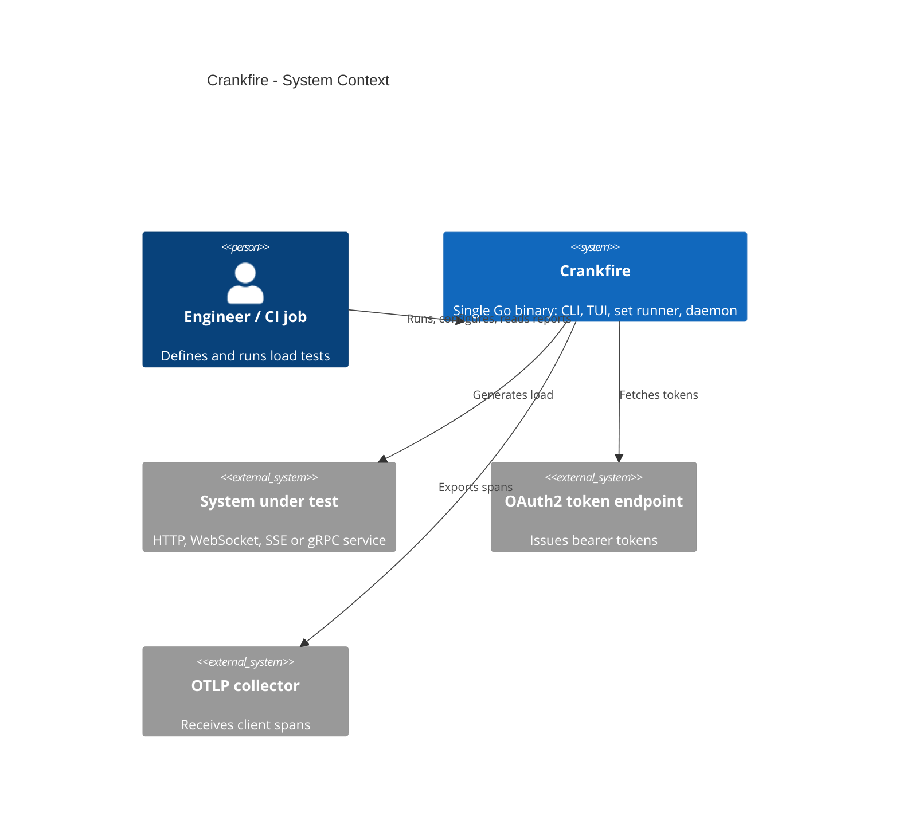
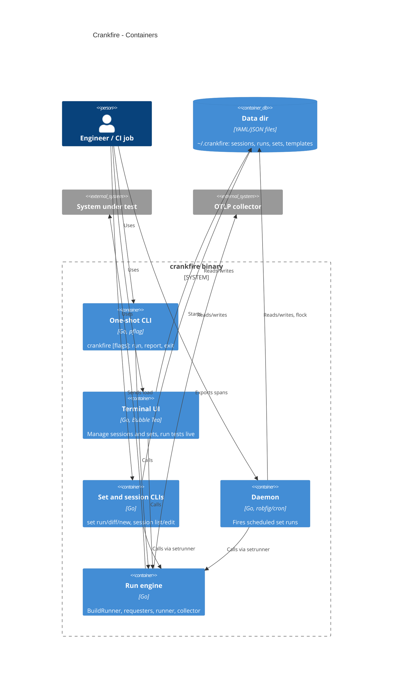
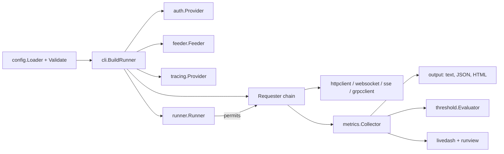
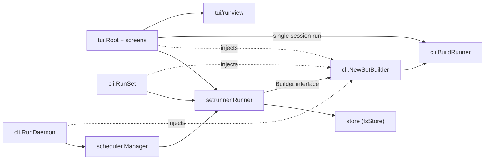



[Docs home](../index.md) · [Overview](1-project-overview.md) · **Architecture** · [Workflows](3-workflow-overview.md)

# Architecture Overview

## System Context (C4 Level 1)

An engineer or a CI job runs Crankfire on one machine. Crankfire sends load to a system under test. It can also fetch OAuth2 tokens from an identity provider and export spans to an OTLP collector.

## Container Architecture (C4 Level 2)

All "containers" here are modes of the same binary. They share the in-process run engine. Only the stateful modes use the data directory.

## Component Architecture (C4 Level 3)

### Run engine

### Stateful layer

## Architectural Patterns

- **Decorator middleware around `runner.Requester`.** A requester has a single method, `Do(ctx) error`. For HTTP, `buildRequester` (`internal/cli/build.go`) wraps the base requester from the inside out: `httpRequester` → `runner.WithLogging` → `runner.WithRetry` → `endpointSelector.Wrap`. Because the selector is the outermost layer, every retry attempt of a request hits the same endpoint. WebSocket, SSE and gRPC requesters are not decorated.
- **Scheduler plus fixed worker pool.** A single scheduler goroutine calls `arrival.Wait` and pushes tokens into a `permits` channel buffered to `Concurrency`. `Concurrency` workers drain it. All pacing happens in one place, and every worker runs flat out (`internal/runner/runner.go`).
- **Pluggable arrival controller.** `uniformArrival` wraps `rate.Limiter`. `poissonArrival` sleeps for exponentially distributed gaps. A pattern controller retunes the rate every 100 ms from a compiled segment plan.
- **Sharded metrics collector.** The collector holds 32 mutex-protected shards, each with its own HDR histogram and counters. Each record goes to a randomly chosen shard. Snapshots merge all shards (`internal/metrics/collector.go`). One global lock remains: `customMu`, which every WebSocket, SSE and gRPC record takes to add its protocol counters.
- **Per-worker context state.** Each worker gets its own `variables.Store` in its context, so request chaining needs no locks and never leaks values between workers.
- **Connection pooling.** WebSocket and SSE clients are pooled per `target + sorted headers` (`internal/pool`). gRPC keeps one multiplexed `ClientConn` per target in a `sync.Map`.
- **Ports and adapters for persistence.** `store.Store` is an interface with a single file-system implementation, `fsStore` (constructed by `store.NewFS`). `setrunner.Builder` is an interface, so tests can inject fake runs.
- **Atomic file writes with lock sidecars.** Writes go to a `.tmp` file followed by `os.Rename`. Saves take an exclusive `gofrs/flock` lock on a `<file>.lock` sidecar. The daemon is held to a single instance by `daemon.lock`.
- **Screen stack.** The TUI root keeps a stack of `tea.Model` screens. Screens navigate by sending `PushMsg` and `PopMsg`.

## Key Design Decisions

1. **One protocol per run, one Requester interface.**
   - *Rationale:* the runner, collector, thresholds and reports stay protocol-agnostic. Protocol-specific counters ride along as `ProtocolMetrics`.
   - *Trade-off:* HTTP-only features (retries, `--log-errors`, weighted endpoints, chaining) are wired only into the HTTP branch. Mixed-protocol scenarios need a set.
2. **Central scheduler instead of per-worker limiters.**
   - *Rationale:* exact global RPS and arrival distributions, and load patterns are easy to apply.
   - *Trade-off:* a single goroutine is the pacing bottleneck. With `rate: 0` the scheduler hands out permits as fast as the workers can take them.
3. **Latency measured from `initRequest` to full body drain.**
   - *Rationale:* the number reflects what a client experiences, including auth token fetch, feeder lookup and connection setup.
   - *Trade-off:* it is not pure server time.
4. **HDR histogram (1 µs to 60 s, 3 significant digits) per shard.**
   - *Rationale:* accurate tails with bounded memory.
   - *Trade-off:* latencies above 60 s are clamped. Memory and snapshot cost grow with shards × endpoints: each histogram is about 139 KB, so each `shardedStats` (32 shards) is about 4.5 MB, for the total and again for every distinct endpoint. A HAR import with 100 endpoints needs roughly 450 MB, and every `Stats()` call merges (endpoints + 1) × 33 histograms. These figures are calculated from the library source, not measured.
5. **Plain files instead of a database for the stateful modes.**
   - *Rationale:* no dependencies, and the files can be diffed and edited by hand (YAML sessions and sets).
   - *Trade-off:* locks cover a single host only. Reads are unlocked and rely on atomic rename.
6. **The TUI, set runner and daemon run the engine in-process.**
   - *Rationale:* no IPC, and they share `cli.BuildRunner` with the CLI.
   - *Trade-off:* the paths differ in important ways:
     - `cfg.Validate()` runs only in `cli.Run` (`internal/cli/run.go:54`). `BuildRunner` does not validate, so TUI, set and daemon runs execute session configs without validation.
     - Single-run `thresholds` in a session are ignored by the TUI and by set items. Sets use their own thresholds.
     - The set builder never calls `collector.Start()`, and its `Run` always returns a nil error. Every item that builds is "completed", whatever its error rate or whether it was cancelled.
     - The TUI marks a single run `failed` as soon as it had any errors.
     - `set run` and `session` get `context.Background()` from `main.go`, with no signal handling. Ctrl+C kills the process, so `set-run.json` stays `running` and cleanup does not run. Only the one-shot run and the daemon handle signals.
   - See [Persistence and Sets](deep-dive/persistence-and-sets.md).
7. **Hand-rolled argument dispatch in `main.go`, not a cobra command tree.**
   - *Rationale:* the default command stays a plain flag set, so `crankfire --target ...` needs no subcommand. cobra is used only as the flag container and help printer for that default command (`internal/config/flags.go`).
   - *Trade-off:* each subcommand parses its own flags. `session` and `set` ignore `--data-dir`.

## Module Breakdown

| Module | Purpose | Key components | Depends on |
|--------|---------|----------------|------------|
| `internal/config` | Parse flags and files, validate | `Config`, `Loader`, `Validate`, `LoadFromFile` | cobra, pflag, viper |
| `internal/cli` | Wiring and subcommands | `Run`, `BuildRunner`, `buildRequester`, `*Requester`, `endpointSelector`, `RunSet`, `RunSession`, `RunDaemon`, `NewSetBuilder` | nearly every package |
| `internal/runner` | Pacing and concurrency | `Runner`, `Options`, `arrivalController`, `patternPlan`, `WithRetry`, `WithLogging` | x/time/rate |
| `internal/metrics` | Measurement | `Collector`, `Stats`, `EndpointStats`, `DataPoint`, `RequestMetadata` | hdrhistogram |
| `internal/output` | Reporting | `PrintReport`, `PrintJSONReport`, `ProgressReporter`, `GenerateHTMLReport`, `setreport.Render` | metrics, threshold (`setreport` also uses setrunner and store) |
| Protocol clients | Wire protocols | `httpclient`, `websocket`, `sse`, `grpcclient`, `pool`, `clientmetrics` | gorilla, grpc, protoreflect |
| Request data | Request content | `placeholders`, `variables`, `extractor`, `feeder`, `auth`, `har` | gjson |
| `internal/threshold` | Pass/fail rules | `Parse`, `ParseMultiple`, `Evaluator` | metrics |
| `internal/tracing` | Observability | `Init`, `StartRequestSpan`, `InjectHTTPHeaders`, `InjectGRPCMetadata` | OTel SDK |
| `internal/store` | Persistence | `Store`, `NewFS`, `Session`, `Run`, `Set`, `SetRun` | yaml.v3, flock, ulid |
| `internal/setrunner` | Suites | `Runner`, `ApplyOverrides`, `EvaluateThresholds`, `Compare`, `Diff` | store, config |
| `internal/scheduler` | Cron | `Manager` | robfig/cron |
| `internal/tui` | Interactive UI | `Root`, `screens/*`, `runview.Model`, `widgets` | Bubble Tea, lipgloss |

Deep dives:

- [Runner Engine](deep-dive/runner-engine.md)
- [Metrics and Reporting](deep-dive/metrics-and-reporting.md)
- [Configuration and Request Building](deep-dive/configuration-and-request-building.md)
- [Protocol Clients](deep-dive/protocol-clients.md)
- [Persistence and Sets](deep-dive/persistence-and-sets.md)
- [Terminal UI](deep-dive/terminal-ui.md)

Next: [Workflow Overview](3-workflow-overview.md).

