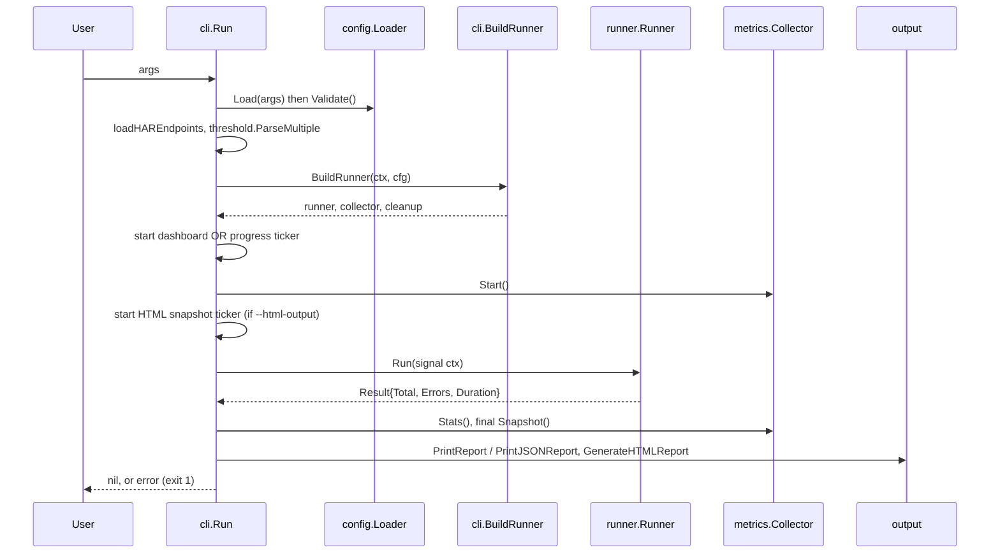
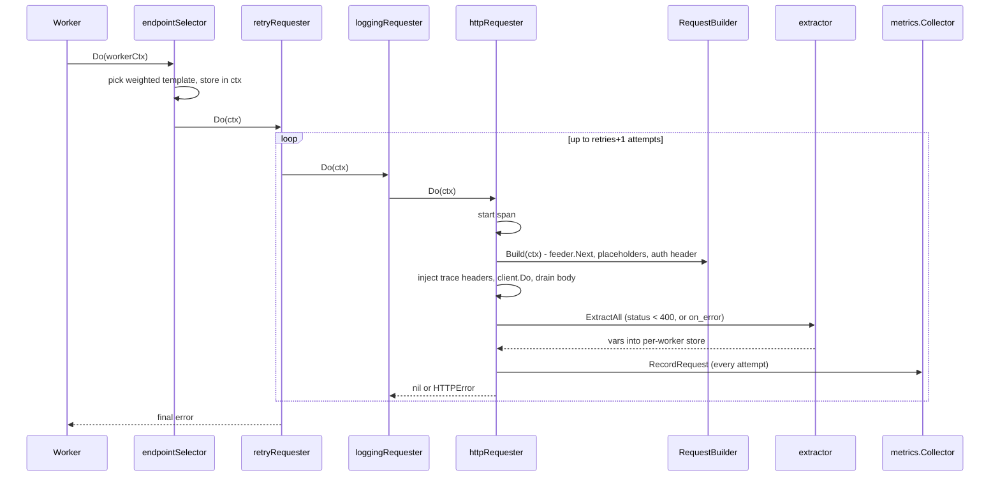
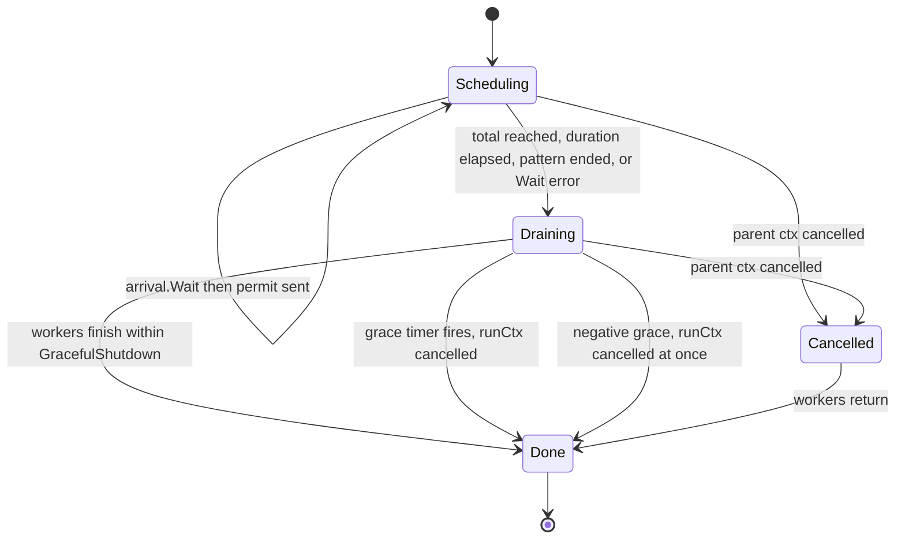
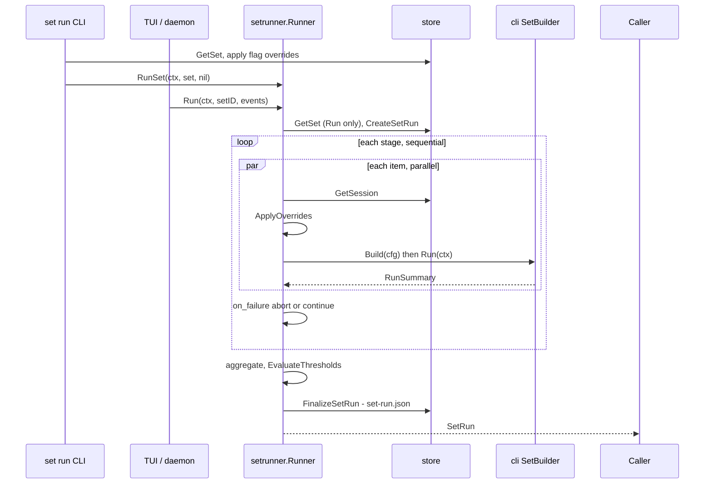
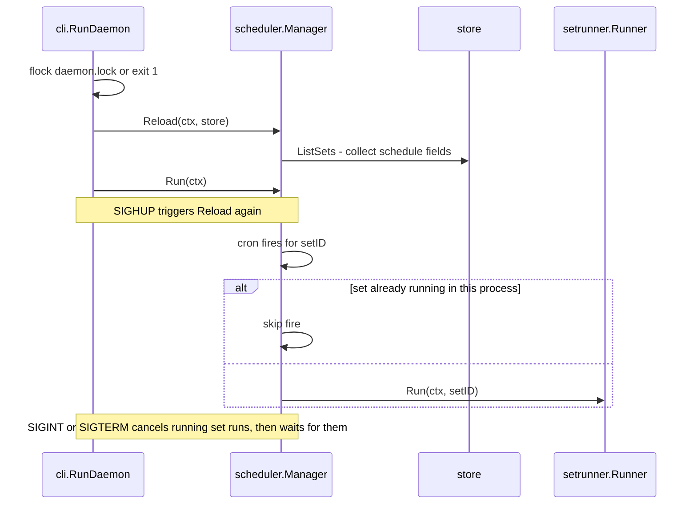
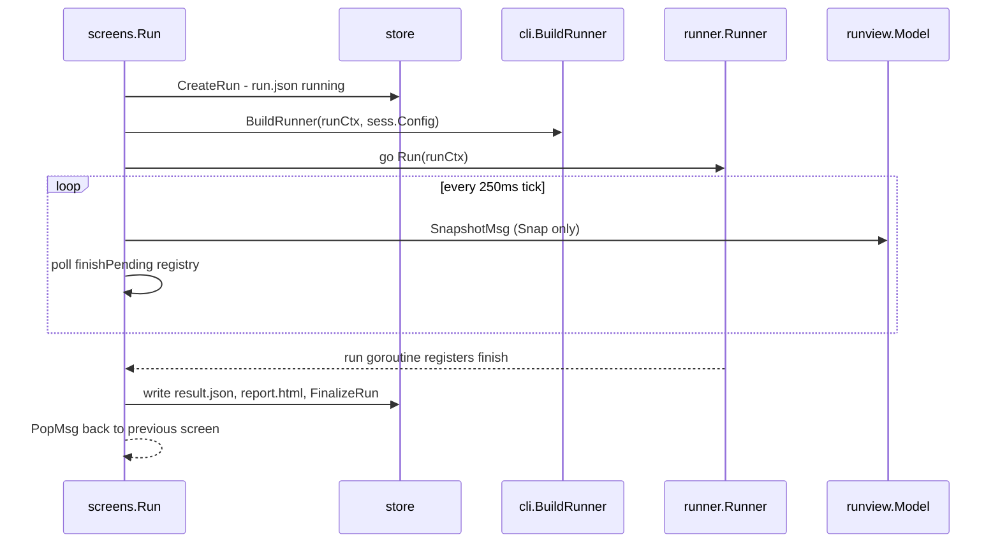
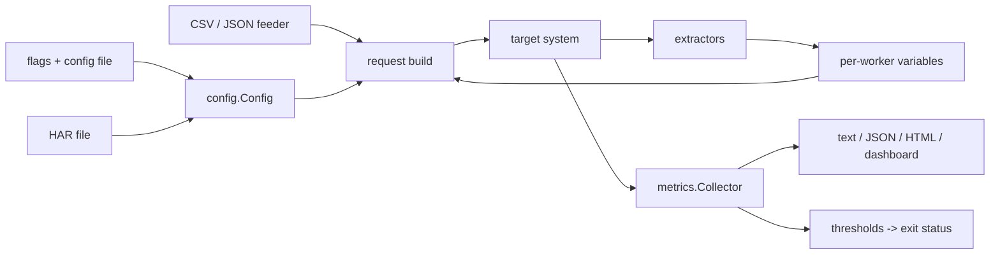



[Docs home](../index.md) · [Overview](1-project-overview.md) · [Architecture](2-architecture-overview.md) · **Workflows**

# Workflow Overview

## 1. One-shot CLI run

`cli.Run` (`internal/cli/run.go`) handles a plain `crankfire [flags]` invocation.

Steps:

1. `config.NewLoader().Load(args)` builds the config in three layers: defaults, then the config file, then flags that were explicitly set. With no arguments it prints help.
2. `cfg.Validate()` collects every validation issue and prints warnings to stderr, for example rate above 1000 or concurrency above 500.
3. `loadHAREndpoints` converts `--har` into `cfg.Endpoints`, then clears `HARFile` so a later call does not import it twice.
4. Thresholds are parsed before the run, so a typo fails fast.
5. `BuildRunner` sets up tracing, auth, the feeder, the collector, the requester chain and `runner.New`. It returns an idempotent `cleanup`. `BuildRunner` does not call `Validate()`. Only this one-shot path validates; the TUI, `set run` and the daemon call `BuildRunner` directly with unvalidated session configs.
6. `signal.NotifyContext` cancels the run on SIGINT or SIGTERM. In dashboard mode, `q`, `esc` and `ctrl+c` call the same cancel function. Cancelling stops in-flight requests at once (no grace window), and they are recorded as failures, so an interrupted run normally exits 1.
7. `--dashboard` starts `livedash`. If neither JSON nor dashboard output is requested, a 1 s `ProgressReporter` writes to stdout.
8. `collector.Start()` stamps the start time. Then, with `--html-output`, a goroutine calls `collector.Snapshot()` every second to build the time series.
9. After `Run` returns, the dashboard stops before the report is printed.
10. Thresholds are evaluated against `collector.Stats`.
11. The text or JSON report goes to stdout. The path of the HTML report goes to stderr.
12. The return value is an error if any threshold failed, otherwise an error if `result.Errors > 0`, otherwise `nil`.

## 2. HTTP request lifecycle

The outer layers are optional:

- The selector exists only when `cfg.Endpoints` is not empty (including HAR imports).
- The retry layer exists only with `retries > 0`.
- The logging layer exists only with `--log-errors`.

Without them, the worker calls `httpRequester` directly.

`httpRequester` records every attempt in the collector, but `Result` counts one entry per scheduled request. With retries enabled the two counts measure different things. An attempt that fails and then succeeds on retry still adds to the collector's `failures` and to thresholds, but not to `Result.Errors`.

A request is retried after HTTP 429, a 5xx, or a network or build error. These are not retried:

- context cancellation;
- request timeouts: `net/http` timeout errors match `context.DeadlineExceeded`, which the policy refuses (`internal/cli/run.go:294`);
- other 4xx responses.

The backoff is `100ms·2^(n-1)`, capped at 5 s, plus up to 50% jitter.

## 3. Runner scheduling and shutdown

`GracefulShutdown` defaults to 5 s. A negative value cancels in-flight requests immediately. The grace window applies only when the run ends on its own. A parent cancel (Ctrl+C, `q` in the dashboard) cancels `runCtx` at once, so in-flight requests fail and are recorded as errors. See [Runner Engine](deep-dive/runner-engine.md).

## 4. Set run

`setrunner.Runner` runs a set (`internal/setrunner/runner.go`). It has two entry points:

- **`Run(ctx, setID, events)`** loads the set itself. The TUI uses it (with a 64-slot events channel), and so does the daemon (with nil events).
- **`RunSet(ctx, set, events)`** takes a set that is already in memory. `crankfire set run` uses it: it calls `GetSet`, adds the `--threshold` and `--override` flags, then calls `RunSet(ctx, set, nil)`.

A failed threshold turns a `completed` set run into `failed`. Items of a stage run in their own goroutines. Events are sent to the caller's channel without blocking, so an event is dropped if the buffer is full.

`main.go` gives `crankfire set` and `crankfire session` a plain `context.Background()`, with no signal handling. Ctrl+C during `set run` kills the process: `set-run.json` stays `running` and cleanup does not run.

## 5. Daemon scheduling

Scheduled runs use the daemon's root context, so a shutdown signal cancels in-flight set runs first. `cron.Stop()` then waits for them with no time limit. The daemon's own 30 s drain timeout (`daemonDrainTimeout`) is reached only after that wait, so it never takes effect.

Logs are JSON lines written to stdout, with the fields `ts`, `level`, `event`, `setID` and `msg`.

## 6. TUI single-session run

## Data Flow

## State Management

| State | Lives in | Scope / lifetime |
|-------|----------|------------------|
| Run configuration | `config.Config`, passed by value | One run |
| Pacing | `arrivalController`, `patternPlan` | Runner |
| Request counters | atomics in `runner.Run` | Runner |
| Latency, outcomes | `metrics.Collector` (32 shards) and `history` slice (unbounded) | Run |
| Chained variables | `variables.Store` in worker context | One worker goroutine |
| Feeder cursor | `feeder.Feeder` behind a mutex, shared | Run |
| OAuth token | `auth.OAuth2Provider` cache | Run |
| Connections | `pool.ConnectionPool` (WS/SSE), `sync.Map` (gRPC), `http.Transport` | Run |
| Sessions, sets, templates | `<data>/sessions`, `sets`, `templates` YAML | Persistent |
| Run history | `<data>/runs/<session>/<ts>/`, `<data>/runs/sets/<set>/<ts>/` | Persistent |
| TUI navigation | `tui.Root.stack` | Process |

## Error Handling and Exit Codes

**Default command (`cli.Run`)**

- Any error returned by `Run` makes the process print `error: ...` and **exit 1**.
- That includes parse and validation errors, failed thresholds, and any failed request (`result.Errors > 0`), even when every threshold passed.
- `--help` exits 0.
- The typed constants `ExitThresholdFailed=2` and `ExitRunnerError=3` are **not** used here.

**`crankfire set run`** (constants in `internal/cli/set.go`)

| Code | Meaning |
|------|---------|
| 0 | Every threshold passed and the set run completed |
| 1 | Usage, parse or lookup error |
| 2 | A threshold failed (checked first) |
| 3 | Runner error, or the run finished with a status other than completed |

**Other subcommands**

- `session` exits 1 for usage errors and for failures to get or save a session. It exits 3 only when listing sessions fails or the store cannot be opened (in `main.go`).
- `daemon` exits 1 if another daemon holds the lock, 3 on store or initial reload failure, and 0 after a clean shutdown.

**Per-request errors**

- They never abort a run. They are counted, put into status buckets (failures only), optionally logged with `--log-errors` (HTTP only), and reflected in thresholds.
- Error classification is described in [Protocol Clients](deep-dive/protocol-clients.md#status-bucket-taxonomy).

