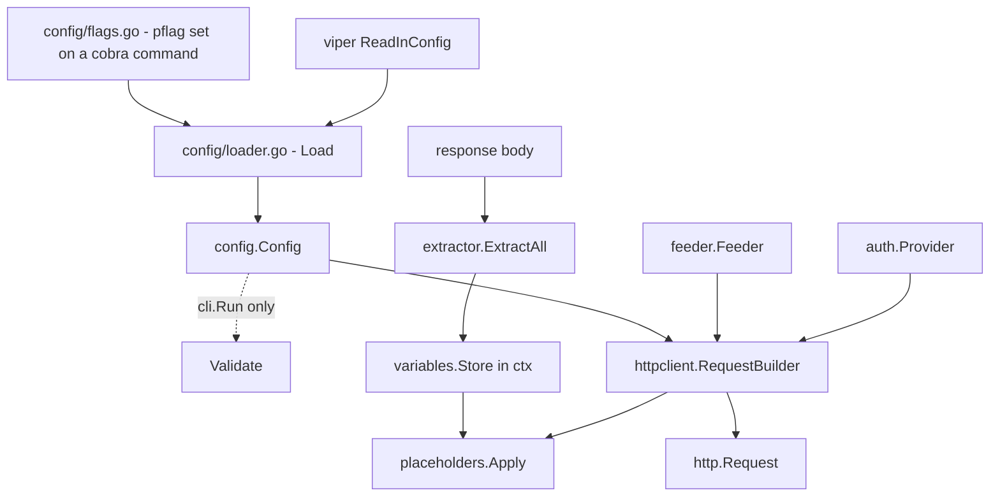



[Docs home](../../index.md) · [Overview](../1-project-overview.md) · [Architecture](../2-architecture-overview.md) · [Workflows](../3-workflow-overview.md)

# Deep Dive: Configuration and Request Building

## Overview

This page covers how user input becomes a validated `config.Config`, and how each request's URL, headers and body are filled in. The supporting packages are placeholders, feeders, the per-worker variable store, extractors, auth providers, HAR conversion, thresholds, tracing, tag filters and set templates.

For the user-facing reference of every key and flag, see [Configuration](../../configuration.md).

## Responsibilities

- Define the flag set and merge flags over the config file, which is merged over the defaults.
- Decode the config by hand from viper's settings map, accepting several key spellings.
- Validate the whole config and collect every issue, and print warnings for risky settings. This happens only on the one-shot `crankfire [flags]` path.
- Build HTTP requests: body source, `{{placeholder}}` substitution, feeder records, auth header.
- Extract values from responses into the worker's variable store.
- Convert HAR recordings into endpoints.
- Parse and evaluate thresholds. Set up OpenTelemetry tracing.

## Architecture



## Key Files

- `internal/config/config.go`: `Config` and its nested structs, `Validate`, `ValidationError`, `TracingConfig.Enabled` and `ShouldPropagate`.
- `internal/config/flags.go`: flag definitions and `applyFlagOverrides`.
- `internal/config/loader.go`: `Loader.Load`, `LoadFromFile`, `applyConfigSettings`, the per-section builders, the auth env-var fallbacks and the HAR pre-check.
- `internal/config/parsers.go`: lenient `as*` converters, `lookupSetting` and `toStringKeyMap`.
- `internal/httpclient/client.go` and `body_reader.go`: `RequestBuilder`, `NewClient` and `BodySource`.
- `internal/placeholders/placeholders.go`: `Apply` and `ApplyToMap`.
- `internal/variables/store.go`: `Store`, `MemoryStore`, `NewContext` and `FromContext`.
- `internal/extractor/`: `ExtractAll` with JSONPath (gjson) and regex.
- `internal/feeder/`: CSV and JSON feeders.
- `internal/auth/`: `Provider`, `OAuth2Provider` and `StaticTokenProvider`.
- `internal/har/`: `Parse`, `Convert` and `ConvertOptions`.
- `internal/threshold/threshold.go`: `Parse`, `ParseMultiple` and `Evaluator`.
- `internal/tracing/`: `Init`, `StartRequestSpan`, `EndSpan` and the inject helpers.
- `internal/tagfilter/` (`Parse`, `Matcher`) and `internal/template/render.go` (`Render`).
- `internal/cli/`: `auth_helpers.go`, `feeder_helpers.go`, `har_loader.go` and `endpoints.go` are the CLI-side factories.

## Implementation Details

### Loading and precedence

`Load(args)` applies settings in three layers:

1. **Struct defaults:** `Method=GET`, `Concurrency=1`, `Timeout=30s`, `GracefulShutdown=5s`, `Arrival=uniform`.
2. **Config file:** read with `viper.SetConfigFile` and `ReadInConfig`, so the format comes from the file extension. `AllSettings()` is then walked by hand.
3. **Flags:** copied over the config only when `fs.Changed(name)` is true.

Viper lowercases every key, so keys are case-insensitive. Most multi-word keys accept the concatenated, snake_case and kebab-case spellings (for example `bodyfile`, `body_file` and `body-file`).

Durations accept Go duration strings or a bare number of seconds. A float is truncated to whole seconds, so `0.5` becomes `0` (`asDuration` in `parsers.go`).

Relative paths (`body_file`, `feeder.path`, `grpc.proto_file`, `har_file`) resolve against the **process working directory**, not the config file's directory.

Crankfire's own code reads these environment variables:

- `CRANKFIRE_AUTH_CLIENT_SECRET`, `CRANKFIRE_AUTH_PASSWORD` and `CRANKFIRE_AUTH_STATIC_TOKEN`. These are used only when an `auth:` block exists and the corresponding field is empty.
- `OTEL_SERVICE_NAME`.
- `CRANKFIRE_DATA_DIR`, read by the store.

Libraries read some more:

- `HTTP_PROXY`, `HTTPS_PROXY` and `NO_PROXY`, through `http.ProxyFromEnvironment`, for HTTP (`httpclient/client.go`) and the WebSocket dialer (`websocket/websocket.go`).
- The OTLP exporters and batch span processor read the standard `OTEL_EXPORTER_OTLP_*` and `OTEL_BSP_*` variables (OTel SDK behaviour; `WithEndpoint` overrides the endpoint variable).

Viper `AutomaticEnv` is not enabled, so there is no general `CRANKFIRE_<KEY>` mapping.

### Validation

`Validate()` collects every problem into a `ValidationError` (`validation failed: a; b`). It is called only by `cli.Run` (`internal/cli/run.go:54`), after `Load`. `BuildRunner` does not call it, so TUI runs, `set run` and daemon runs use the session config unvalidated. `store.ImportSessionFromConfigFile` (through `LoadFromFile`) does not validate either.

It covers:

- the target (not required with HAR, or when every endpoint has a `url`);
- non-negative numbers;
- `body` and `body_file` set together, and `dashboard` and `json_output` set together (both are errors);
- the arrival model and load patterns;
- endpoints: weight of at least 1, case-insensitive unique names, extractors that have a valid identifier as `var` and exactly one of `jsonpath` or `regex`;
- the auth type and its required fields;
- the feeder type;
- the protocol and its timeouts, and the gRPC service and method. `grpc.proto_file` is not required here; a missing file fails every request at run time (`internal/cli/grpc_requester.go:185-188`).

It writes warnings to stderr for:

- rate above 1000 and concurrency above 500;
- the legacy password grant;
- static OIDC tokens;
- `grpc.insecure`.

### Request building (HTTP)

`NewRequestBuilder*` checks that the target is not empty and that header keys are not empty. Header keys and values must not contain CR or LF. It then picks a `BodySource`:

| `BodySource` | Used for |
|--------------|----------|
| inline | `body` |
| file | `body_file`; re-opened and streamed on every request |
| empty | no body |

The body is scanned once for `{{`. A body without placeholders is always streamed as is.

`Build(ctx)` does the following, in order:

1. `feeder.Next(ctx)`, if a feeder is configured.
2. Get the variable store from `variables.FromContext(ctx)`.
3. Apply placeholders to the URL.
4. Apply placeholders to the body, buffering it first, if it contains placeholders.
5. Apply placeholders to header **values** (not keys).
6. Have the auth provider set `Authorization: Bearer ...`. This overwrites any user-supplied value.

`NewClient(timeout)` builds the shared transport with:

- `ProxyFromEnvironment`;
- a 30 s dial timeout and keepalive;
- HTTP/2 attempted;
- 256 idle connections in total and 32 per host;
- a 90 s idle timeout and a 10 s TLS handshake timeout.

Redirects are followed using Go's defaults.

### Endpoints

`internal/cli/endpoints.go` builds one `RequestBuilder` per endpoint:

- **Settings:** method, headers and body are merged from global and endpoint values, with endpoint values winning.
- **URL:** an endpoint `url` is used as is. Otherwise the global target is resolved against the endpoint's `path` with `url.ResolveReference`, and percent-encoded `{{ }}` is restored to braces.
- **Weight:** defaults to 1.
- **Selection:** a cumulative-weight random draw under a mutex.
- **Name:** the endpoint name, or the resolved URL when no name is given. It is used as the metrics key.

### Placeholders vs. templates

**`placeholders.Apply`** handles the request templates. Its pattern is `{{key}}` or `{{key|default}}`, matched by the regex `\{\{([^}|]+)(?:\|([^}]*))?\}\}`. Keys are not trimmed.

- **With a variable store:** the lookup order is store → feeder record → default. HTTP always runs this way.
- **Without a store:** only exact `{{key}}` from the feeder record is replaced. WebSocket, SSE and gRPC run this way.
- Values are inserted as is, with no URL or JSON escaping. A feeder value `red shoes` in a query string produces an invalid request line.
- An unmatched placeholder becomes `""` on the store path (HTTP), but is left unchanged on the no-store path (WebSocket, SSE, gRPC). The store path is meant to keep `match` when there is no `|default`. In practice it never does: `FindStringSubmatch` always returns three elements because the default group is optional, so `len(parts) > 2` is always true (`internal/placeholders/placeholders.go`).

**`internal/template.Render`** is unrelated to requests. It is Go `text/template` (`{{.param}}`, with the functions `default`, `lower` and `upper`, and `missingkey=zero`). It is used only for set templates (`set new --from-template` and the TUI template picker).

### Variables and extractors

There is one `MemoryStore` per worker goroutine. It is a map without locks, created in `runner.Run`.

After an HTTP response is received:

- **Status below 400:** all extractors run.
- **Status 400 or above:** only extractors with `on_error: true` run.
- **Body limit:** only the first 1 MB of the body is read.

The two extractor types work as follows:

- **JSONPath** uses gjson. A leading `$.` is stripped, and `$` alone means `@this`. Non-string results are returned as raw JSON.
- **Regex** returns the first capture group, or the whole match if the pattern has no groups. The pattern is compiled on every call.

When an extraction fails, a warning is logged to stderr and the variable is set to `""`.

### Feeders

- `Record` is a `map[string]string`.
- The CSV feeder reads its header row, skips leading spaces, and rejects a file with no data rows.
- The JSON feeder requires an array of objects. It decodes with `UseNumber` and converts each value with `%v`.
- Both feeders hand out records round-robin under a mutex and **wrap around forever**.
- The CLI wraps the feeder in `sharedFeeder`, which copies each record.

### Auth

The provider is chosen from the `auth.type` value:

| `type` | Provider |
|--------|----------|
| `oauth2_client_credentials` | `OAuth2Provider`, using the client-credentials grant |
| `oauth2_resource_owner` | `OAuth2Provider`, using the password grant |
| `oidc_implicit`, `oidc_auth_code` | `StaticTokenProvider(static_token)` |

`OAuth2Provider` behaviour:

- **Request:** it POSTs a form to `token_url`, sending the client ID and secret with HTTP Basic auth and joining scopes with spaces. The token request has a 30 s timeout.
- **Cache lifetime:** `expires_in` (1 h if it is missing) minus `min(refresh_before_expiry, lifetime/2)`. The CLI default for `refresh_before_expiry` is 30 s.
- **Refresh:** tokens are fetched on the first request and again when the cached one expires. Concurrent callers share a single in-flight fetch through a `sync.Cond`. There is no background refresh and no `refresh_token` flow.

### HAR conversion

`har.Parse` reads HAR 1.2 data. `Convert` turns entries into endpoints using these options:

- **Defaults:** `ExcludeStatic` and `IncludeHeaders` are on.
- **Static assets:** dropped by path suffix (`.js`, `.css`, images, fonts, `.map`).
- **Headers dropped:** hop-by-hop headers, `host`, `content-length` and `:pseudo` headers. `Cookie` and `Authorization` are kept.
- **Filters:** the CLI parses `host:a,b;method:GET,POST`. Host matching is exact and includes the port.
- **Endpoint fields:** `URL` is the full recorded URL (so `path` is never used to resolve it). `Name` and `Path` are the URL path, `Method` is copied verbatim, `Body` comes from `postData.text`, and `Weight` is 1 (`internal/har/converter.go:98-121`).
- Like all endpoints, HAR endpoints apply only to the HTTP protocol (`internal/cli/build.go:119-171`).

The HAR endpoints are added **after** `Validate`, so duplicate names are not caught.

### Thresholds

The grammar is `^([a-z_]+):([a-z0-9]+)\s*(<|<=|>|>=|==)\s*(number)$`. The metric and aggregate combinations are:

| Metric | Aggregates | Value |
|--------|------------|-------|
| `http_req_duration` | `p50`, `p90`, `p95`, `p99`, `avg`, `min`, `max` | milliseconds |
| `http_req_failed` | `count`, `rate` | failure count, or failures / total |
| `http_requests` | `count`, `rate` | total requests, or RPS |

- Other combinations parse but fail at evaluation time.
- `<=`, `>=` and `==` use an epsilon of 1e-9. `<` and `>` are exact (`threshold.go:257-266`).
- Despite the `http_` names, thresholds apply to every protocol.

### Tracing

`Init` returns a no-op provider unless `tracing.endpoint` is set. When tracing is enabled it sets up:

- **Exporter:** OTLP over gRPC (the default) or HTTP, with an optional insecure connection.
- **Resource:** `service.name` comes from the config, then `OTEL_SERVICE_NAME`, then `crankfire`.
- **Processing:** a batch span processor.
- **Sampler:** `ParentBased` wrapping one of three samplers: `AlwaysSample` at rate 1, `TraceIDRatioBased` between 0 and 1, and `NeverSample` at 0.
- **Propagators:** TraceContext and Baggage, registered globally.

Request spans are of kind Client and named `"<protocol> <endpoint>"` or `"<protocol> request"`. They carry the attributes `rpc.system` and `crankfire.endpoint`.

### Tag filters

A tag filter expression consists of groups separated by whitespace, which are combined with AND. Inside a group, commas mean OR. Tokens must match `^[a-zA-Z0-9._-]{1,64}$`, and matching is case-sensitive. Tag filters are used by `session list --tag`, `set list --tag` and the TUI filter bar.

## Dependencies

- Internal: `config` is imported by most packages. `httpclient` depends on `placeholders`, `variables` and `config`. `threshold` depends on `metrics`.
- External: viper, cobra (as the flag container and help printer, with no subcommand tree), pflag, yaml.v3, gjson, and the OpenTelemetry SDK with its OTLP exporters.

## API/Interface

```go
func NewLoader() *Loader
func (Loader) Load(args []string) (*Config, error)        // ErrHelpRequested on --help / no args
func LoadFromFile(path string) (*Config, error)
func (c Config) Validate() error
func NewRequestBuilderWithAuthAndFeeder(cfg *config.Config, p AuthProvider, f Feeder) (*RequestBuilder, error)
func (b *RequestBuilder) Build(ctx context.Context) (*http.Request, error)
func Apply(tmpl string, record map[string]string, stores ...variables.Store) string
func ParseMultiple([]string) ([]threshold.Threshold, error)
func Init(ctx context.Context, cfg config.TracingConfig) (*tracing.Provider, error)
```

## Testing

- `internal/config`: `config_test.go`, `loader_test.go` and `extractors_test.go` cover validation, aliases and precedence.
- `internal/httpclient`: `client_test.go` and `body_reader_test.go`.
- Each supporting package (`placeholders`, `feeder`, `extractor`, `auth`, `har`, `threshold`, `tracing`, `tagfilter`, `template`) has a `*_test.go`. `auth` adds `oauth2_cache_test.go` and `oauth2_security_test.go`.
- `internal/cli`:
  - `features_matrix_auth_test.go` covers auth.
  - `features_matrix_feeders_test.go` covers feeders.
  - `features_matrix_thresholds_test.go` covers thresholds.
  - `har_integration_test.go` covers HAR import.
  - `samples_test.go` parses the shipped sample configs.

## Known Issues & Improvement Opportunities

- **Flag defaults only apply when the flag is passed.**
  - `applyFlagOverrides` copies a flag only when `fs.Changed`, and `Load` seeds only five defaults (`internal/config/loader.go:63-71`, `flags.go`).
  - Effective defaults are therefore 0 for `ws-receive-timeout`, `sse-read-timeout`, `grpc-timeout` and `tracing-sample-rate`, even though `--help` shows 10s, 30s, 30s and 1.0.
- **Tracing samples nothing by default.**
  - Because of the previous issue, setting only `--tracing-endpoint` (or `tracing.endpoint` without `sample_rate`) gives `SampleRate=0`, which means `NeverSample` (`internal/tracing/provider.go:73-78`).
  - Users must set `sample_rate` explicitly.
- **`OTEL_EXPORTER_OTLP_ENDPOINT` is never used.**
  - The fallback in `Init` (`provider.go:47-52`) is unreachable, because `cfg.Enabled()` already returned when the endpoint was empty (`provider.go:34`).
- **CSV parsing of list flags.** `--header`, `--threshold` and `--ws-messages` are pflag `StringSlice` flags (`flags.go:31,60,80`), which parse each value as CSV. A value is split on commas, and a value that contains a double quote is rejected (`bare " in non-quoted-field`) unless the whole value is CSV-quoted. So `--ws-messages '{"type":"ping"}'` fails at flag parsing.
- **Chaining is HTTP-only.**
  - WebSocket, SSE and gRPC call `placeholders.Apply` without a store, so extracted variables and `{{k|default}}` do nothing there.
- **A failed extraction overrides defaults and feeder values.** It stores `""`, which then takes precedence over the feeder record and over `|default`.
- **Misleading feeder error and dead code.** `RequestBuilder.Build` wraps every feeder error as `feeder exhausted: ...` (`client.go:174`). `feeder.ErrExhausted` is never returned.
- **The `mean` aggregate is rejected.** `isValidAggregate` refuses `mean`, so its evaluation branch is unreachable (`threshold.go:174,216`).
- **Tag filter spacing.** Normalization breaks on two or more spaces on either side of a comma: `"a  ,b"` and `"a,  b"` both become an empty-token error (`internal/tagfilter/parser.go:26-28`).
- **Relative paths resolve against the CWD.** Paths are not resolved relative to the config file, which surprises users who run `--config dir/x.yaml` from elsewhere.
- **No auth flags.** Auth can only be configured in a file.
- **Validation is skipped outside the one-shot CLI.** `BuildRunner` never calls `Validate`, so sessions run from the TUI, `set run` or the daemon can carry invalid values that `crankfire --config` would reject. Session `config.thresholds` are also never evaluated on those paths.
- **No escaping of placeholder values.** Values are inserted verbatim into URLs, headers and JSON bodies (`internal/placeholders/placeholders.go`, `httpclient/client.go:183`).

