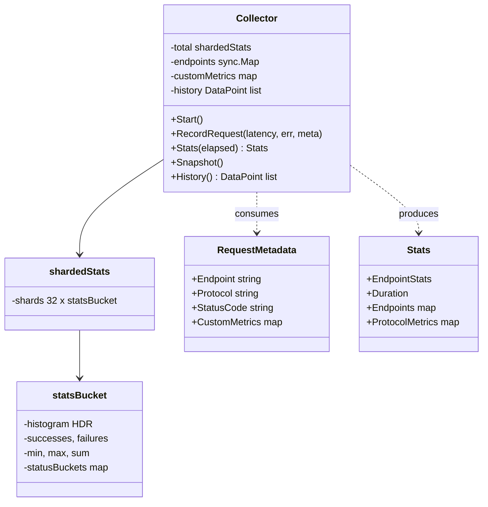



[Docs home](../../index.md) · [Overview](../1-project-overview.md) · [Architecture](../2-architecture-overview.md) · [Workflows](../3-workflow-overview.md)

# Deep Dive: Metrics and Reporting

## Overview

Measurement and presentation are split into separate packages:

- `internal/metrics` collects latency and outcome data concurrently and produces `Stats` and a time series.
- `internal/clientmetrics` provides raw counters for the stateful protocol clients.
- `internal/output` renders the text report, the JSON report, a progress ticker and an HTML report.
- `internal/output/setreport` renders an offline HTML page for a set run.

User-facing descriptions of these outputs are in [Dashboard & Reporting](../../dashboard-reporting.md).

## Responsibilities

- Record each request's latency, success or failure, endpoint, protocol, status code and custom counters.
- Compute overall and per-endpoint min, max, mean, P50, P90, P95, P99 and RPS.
- Keep a status-bucket breakdown per protocol for failures.
- Aggregate protocol metrics such as WebSocket message counts.
- Append time-series `DataPoint`s for the dashboard and the HTML charts.
- Render the reports.

## Architecture



## Key Files

- `internal/metrics/collector.go`: `Collector`, `shardedStats`, `statsBucket`, `Stats`, `EndpointStats`, `DataPoint`, `RequestMetadata`, and `aggregateMetric`.
- `internal/metrics/status.go`: `StatusBucket` and `FlattenStatusBuckets` (sorted by count descending, then protocol, then code).
- `internal/clientmetrics/metrics.go`: `ClientMetrics` counters and `Snapshot()`.
- `internal/output/report.go`: `PrintReport`, `PrintJSONReport`, `JSONReport`, and `ThresholdResultJSON`.
- `internal/output/progress.go`: `ProgressReporter`.
- `internal/output/html.go`: `GenerateHTMLReport` and the inline `htmlTemplate`.
- `internal/output/setreport/html.go`: `Render(store.SetRun)`.

## Implementation Details

### Collector

**Sharding.** `RecordRequest` picks one of 32 shards with `rand.Intn` and updates that shard while holding its mutex. Each shard keeps:

- an HDR histogram, `hdrhistogram.New(1, 60_000_000, 3)`, holding microseconds from 1 µs to 60 s at 3 significant figures, with clamping;
- success and failure counts;
- exact min, max and sum;
- `statusBuckets[protocol][code]`.

Status buckets are recorded **only for failures** whose protocol and code are both non-empty.

**Endpoints.** Per-endpoint stats are another `shardedStats` stored in a `sync.Map`, keyed by `RequestMetadata.Endpoint`.

**Stats.** `Stats(elapsed)` merges all shards into freshly allocated histograms. It does this for the total and again for every endpoint. RPS is computed only once at least 100 ms have elapsed.

**Elapsed time.** Once `Start()` has been called, `Stats` ignores its `elapsed` argument and uses `time.Since(startTime)` instead.

**Custom metrics.** Values with int, int64 or float64 type are summed. Any other type keeps the last value written.

**Time series.** `Snapshot()` appends `DataPoint{timestamp, total_requests, successful_requests, errors, current_rps, p50/p95/p99_latency_ms}`:

- `current_rps` is the request count added since the previous snapshot, divided by the interval in seconds. It is 0 when the interval is under 100 ms.
- The percentiles are **cumulative** since the start of the run.
- `History()` returns a copy of the series.

### clientmetrics

`ClientMetrics` holds one mutex over the connect timestamp, messages and bytes sent and received, and an error count. The WebSocket, SSE and gRPC clients each hold a `*clientmetrics.ClientMetrics` field.

- The WebSocket and SSE requesters subtract a before snapshot from an after snapshot to get per-request counts. `connection_duration_ms` is the exception: it is the absolute age of the connection, not a delta.
- The gRPC requester builds a new `Client` for every call, so it reports that client's absolute values, and only for successful calls.

See [Protocol Clients](protocol-clients.md).

### Text report (`PrintReport`)

The report has these sections, in order:

1. `--- Load Test Results ---`, followed by totals, duration and Requests/sec.
2. Latency: Min, Max, Mean, P50, P90, P95, P99.
3. `Status Buckets:`, one line per bucket such as `HTTP 503: 12`.
4. Thresholds, followed by `Threshold Summary: X/Y passed`.
5. Endpoint breakdown, sorted by total.
6. Protocol metrics, sorted by key.

### JSON report (`PrintJSONReport`)

`JSONReport` embeds `metrics.Stats`, so the fields are flat. The output is pretty-printed with a two-space indent.

| Key | Notes |
|-----|-------|
| `total`, `successes`, `failures`, `requests_per_sec` | |
| `min_latency_ms`, `max_latency_ms`, `mean_latency_ms` | |
| `p50_latency_ms`, `p90_latency_ms`, `p95_latency_ms`, `p99_latency_ms` | |
| `status_buckets` | `{protocol: {code: count}}`, omitted when empty |
| `duration_ms` | |
| `endpoints` | `{name: <same per-endpoint shape>}`, omitted when empty |
| `protocol_metrics` | `{protocol: {key: value}}`, omitted when empty |
| `thresholds` | `{total, passed, failed, results: [{threshold, metric, aggregate, operator, expected, actual, pass}]}`, omitted when empty |

### Progress ticker

`NewProgressReporter(collector, 1s, os.Stdout)` writes `\rRequests: N | Successes: N | Failures: N | RPS: x.x` on each tick. It appends the top endpoint with its share and P99. It also appends the name of one protocol from `ProtocolMetrics`, but without any values. `Start` and `Stop` are guarded by CAS.

### HTML report

`GenerateHTMLReport(w, stats, history, thresholdResults, ReportMetadata{TargetURL, TestedEndpoints})` renders an `html/template` string constant. The template is not embedded with `go:embed`.

The report contains:

- summary cards;
- RPS and latency charts drawn with **uPlot 1.6.24 from the jsDelivr CDN**, shown only when history exists;
- a latency grid;
- a thresholds table;
- an endpoint breakdown;
- the tested-endpoint list.

History is embedded as a JSON string and parsed in the browser with `JSON.parse`. The report does **not** include status buckets or protocol metrics.

### Set report

`setreport.Render(store.SetRun)` produces a fully offline page with inline CSS and no JavaScript. It contains:

- a status badge, the start time and the duration;
- threshold results;
- per-stage item rows with p50, p95 and p99, RPS, error rate and error text;
- a Compare table built by `setrunner.Compare`, with the winner cell marked.

## Dependencies

- Internal: `metrics` is a leaf package. `output` depends on `metrics` and `threshold`. `setreport` depends on `store` and `setrunner`.
- External: `HdrHistogram/hdrhistogram-go`, and the uPlot CDN when the HTML report is viewed.

## API/Interface

```go
func NewCollector() *Collector
func (c *Collector) RecordRequest(latency time.Duration, err error, meta *RequestMetadata)
func (c *Collector) Stats(elapsed time.Duration) Stats
func (c *Collector) Snapshot()
func (c *Collector) History() []DataPoint
func PrintReport(w io.Writer, s metrics.Stats, th []threshold.Result)
func PrintJSONReport(w io.Writer, s metrics.Stats, th []threshold.Result) error
func GenerateHTMLReport(w io.Writer, s metrics.Stats, h []metrics.DataPoint, th []threshold.Result, m ReportMetadata) error
func Render(run store.SetRun) ([]byte, error) // setreport
```

## Testing

- `internal/metrics`:
  - `collector_test.go` covers basic stats.
  - `shards_test.go` covers concurrent recording.
  - `collector_custom_test.go` covers custom metric aggregation.
  - `json_errors_test.go` and `status_test.go` cover status buckets.
- `internal/output`: `report_test.go`, `progress_test.go` and `html_test.go`.
- `internal/output/setreport/html_test.go` compares output against the golden file `testdata/expected.html`.
- `internal/cli/features_matrix_summary_test.go` exercises the reports end to end.

## Known Issues & Improvement Opportunities

- **Set report error rate.** `setreport` prints `errRate` (a fraction from 0 to 1) with `%.2f%%`, so 2 errors in 80 requests shows as `0.03%` instead of `2.50%` (`internal/output/setreport/html.go:70,104`). The golden file has the wrong value baked in.
- **Progress line order.** In `cli.Run` the progress reporter is stopped only by a `defer` (`internal/cli/run.go:105-108`). That defer runs after `PrintReport` and after the HTML report is written, then prints a trailing newline. A final `\rRequests: ...` tick can therefore appear after the report.
- **Summed duration metric.** `connection_duration_ms` is the absolute connection age, and it is summed across requests, so overlapping time is counted many times. gRPC `status_code` uses last-write-wins (`aggregateMetric`). Neither aggregate is meaningful.
- **Cumulative percentiles.** Time-series percentiles cover the whole run so far, not each interval, so the charts hide latency spikes late in a run.
- **Mixed snapshot intervals.** When `--dashboard` and `--html-output` are used together, both call `Snapshot()`, at 500 ms and 1 s, so the history has irregular intervals. When the two land within 100 ms of each other, that point gets `current_rps` 0, which shows up as a false dip in the RPS chart.
- **Unbounded history.** HTML runs add one point per second, and the dashboard adds more. The TUI snapshots every 250 ms, which is four points per second for the whole run.
- **Global lock for custom metrics.** Every WebSocket, SSE and gRPC record takes `customMu` (`collector.go:38,142-149`) to add its protocol counters, so all workers contend on that one lock. Shard selection is not a problem: top-level `math/rand` functions use a lock-free source since Go 1.20. The package doc's "atomic operations" claim is inaccurate: the shards use mutexes.
- **Histogram memory per endpoint.** `hdrhistogram.New(1, 60_000_000, 3)` allocates about 139 KB. Each `shardedStats` has 32 of them, about 4.5 MB, for the total and again for every distinct endpoint. A HAR import with 100 endpoints therefore needs roughly 450 MB. Every `Stats()` call also allocates and merges (endpoints + 1) × 33 histograms, and the dashboard does this every 500 ms. These figures are calculated from the library source, not measured.
- **Offline viewing.** The HTML report needs network access to render its charts. Vendoring uPlot inline would make it fully offline.
- **Unstable sort.** The text report's endpoint breakdown, the HTML report (`html.go:72`) and the progress line's top endpoint (`progress.go:90`) sort by total with no tiebreak, so endpoints with equal totals can appear in any order. livedash breaks ties by name.

