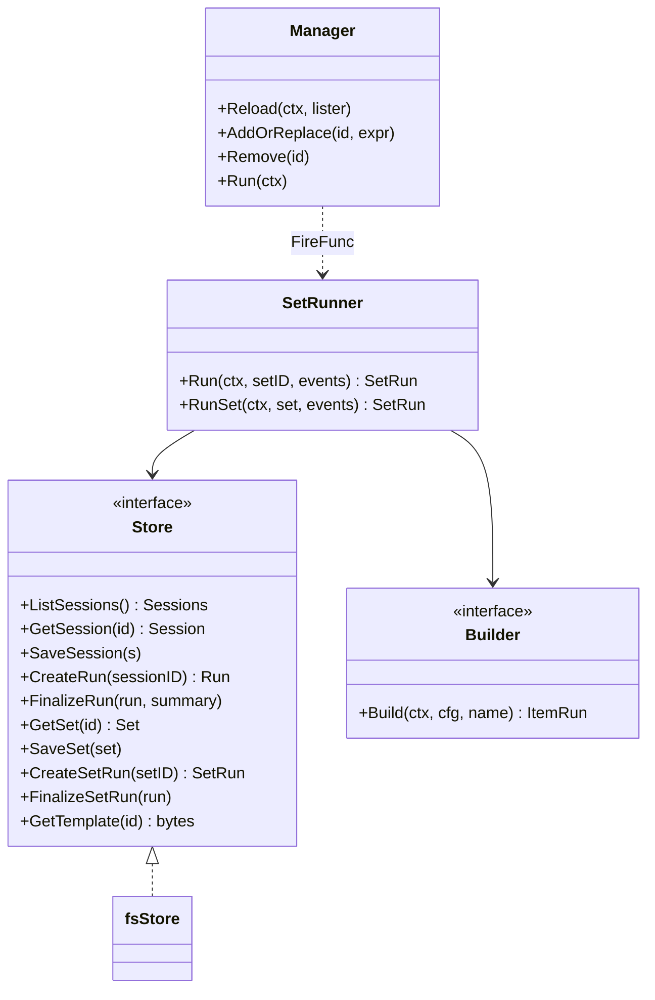



[Docs home](../../index.md) · [Overview](../1-project-overview.md) · [Architecture](../2-architecture-overview.md) · [Workflows](../3-workflow-overview.md)

# Deep Dive: Persistence and Sets

## Overview

The stateful features are saved sessions, run history, sets, set templates and scheduled runs. They are built from four parts:

- `internal/store`: a file-system repository.
- `internal/setrunner`: executes a set and compares runs.
- `internal/scheduler`: a cron manager.
- `internal/cli`: the `session`, `set` and `daemon` subcommands.

The plain `crankfire [flags]` command never touches the store.

User guides: [Sets, Sessions & Scheduling](../../sets.md) and [Terminal UI](../../tui.md).

## Responsibilities

- Persist sessions (a name, tags and a full `config.Config`), sets and templates as YAML. Persist run records as JSON.
- Keep every path inside the data dir, and write files atomically.
- Run sets: stages in sequence, the items of a stage in parallel, with overrides, failure policy and thresholds.
- Compare the items of one set run, and diff two runs of the same set.
- Fire scheduled sets from cron expressions, one run per set at a time.

## Architecture



The Go type for `SetRunner` is `setrunner.Runner`. `setrunner` depends only on its `Builder` interface and never imports `cli`. The callers (the daemon, the TUI and `set run`) inject `cli.NewSetBuilder()`, which wraps `cli.BuildRunner`.

## Key Files

- `internal/store/store.go`: the `Store` interface and the `Session`, `Run` and `RunSummary` types.
- `internal/store/sets.go`: the `Set`, `Stage`, `SetItem`, `Override`, `Threshold`, `SetRun`, `StageResult` and `ItemResult` types.
- `internal/store/fs.go`, `sets_fs.go`, `paths.go`, `errors.go`: the `fsStore` implementation, validation, atomic writes, ID checks and data-dir resolution.
- `internal/setrunner/runner.go`: `Runner`, `Builder`, `ItemRun`, `Event`, the aggregate, and finalization.
- `internal/setrunner/overrides.go`: `ApplyOverrides`.
- `internal/setrunner/threshold.go`: `MetricSnapshot` and `EvaluateThresholds`.
- `internal/setrunner/compare.go` and `diff.go`: `Compare` and `Diff`.
- `internal/scheduler/manager.go`: `Manager`.
- `internal/cli/session.go`, `set.go`, `daemon.go`: the subcommands, plus `NewSetBuilder` and the exit codes.

## Implementation Details

### Data directory layout

The data directory is resolved in this order: an explicit `--data-dir`, which only `tui` and `daemon` accept; then `$CRANKFIRE_DATA_DIR`; then `~/.crankfire`. `NewFS` creates the root, `sessions/`, `runs/`, `sets/` and `runs/sets/` with mode 0700. `templates/` is created lazily:

```text
<data>/
  daemon.lock
  sessions/<ULID>.yaml            (+ .lock sidecar)
  runs/<sessionID>/<RFC3339Nano>/run.json
                                 result.json, report.html   (TUI runs only)
  sets/<ULID>.yaml                (+ .lock sidecar)
  runs/sets/<setID>/<2006-01-02T15-04-05.000000000Z>/set-run.json
                                                     items/  (created, unused)
  templates/<id>.yaml             (+ .lock sidecar; must contain top-level `template: true`)
```

**IDs.** IDs are ULIDs from `oklog/ulid/v2`. `validateID` rejects:

- empty IDs, `.`, `..` and any ID containing `..`;
- IDs containing `/`, `\`, NUL, CR or LF;
- anything that is not equal to `filepath.Base(id)`.

**Writes.** `writeAtomic` writes `<path>.tmp` with mode 0600, then renames it into place. It does not call fsync. `SaveSession`, `SaveSet` and `SaveTemplate` also hold an exclusive `flock` on `<file>.lock`. Reads take no lock.

**Session format.** Sessions are YAML containing `schema_version`, `id`, `name`, `description`, `tags`, `created_at`, `updated_at` and `config`. `config.Config` has no yaml tags, so the keys of the nested `config` block are yaml.v3's lowercased field names: `targeturl`, `loadpatterns` and so on. They are not the snake_case keys a config file uses.

**Validation on save:**

- **Session tags** must match `^[a-zA-Z0-9._-]{1,64}$`. They are de-duplicated and sorted.
- **Sets** must have:
  - a non-empty name of at most 200 bytes;
  - at least one stage, and at least one item per stage;
  - item names that are unique within their stage;
  - only `session_id`s that exist;
  - an `on_failure` value that is empty, `abort` or `continue`;
  - thresholds with both a metric and an op;
  - a `schedule` that parses as 5-field cron or a descriptor such as `@daily` or `@every 5m`.

**Import.** `ImportSessionFromConfigFile` loads the file with `config.LoadFromFile` (no `Validate`) and saves it. It returns the session as it was **before** saving, with an empty ID and zero timestamps, because `SaveSession` takes the session by value (`internal/store/fs.go:162-171`).

**`FinalizeRun` status.** An empty or `running` status becomes `completed`. A `completed` run with a non-empty `ErrorMessage` becomes `failed`.

### Set execution

`Runner.Run` loads the set from disk and forces `set.ID` to the requested ID. The TUI and the daemon use it. `Runner.RunSet` runs a set from memory; `crankfire set run` uses it, after loading the set itself and applying the `--threshold` and `--override` flags without saving them.

Set IDs come from the `id:` field inside the YAML, not from the file name. `ListSets` returns each set with whatever `id:` its file contains (`internal/store/sets_fs.go:29-34`).

Item configs come from the session store and go straight to `BuildRunner`, which does not call `config.Validate`. Session `config.thresholds` are not evaluated for set items; only set thresholds apply.

Execution then proceeds:

1. `CreateSetRun`.
2. For each stage, in order:
   1. Start a goroutine per item and wait for all of them.
   2. If the context was cancelled, set the run status to `cancelled` and stop.
   3. If any item did not complete, apply `on_failure`. An empty value or `abort` marks the run `failed` and stops it. `continue` moves on to the next stage.
3. Aggregate the item results and evaluate thresholds. If any threshold fails, a `completed` run becomes `failed`.
4. `FinalizeSetRun` writes `set-run.json`.

**Per item (`runItem`):**

1. `GetSession`.
2. `ApplyOverrides`.
3. `builder.Build(ctx, cfg, name)`.
4. `ItemRun.Run(ctx)`, which returns a `RunSummary`.

Set items do not create session `Run` records.

**Events.** Events (set, stage or item started and ended) are sent without blocking. If the caller's buffer is full, the event is dropped.

**Overrides.**

- Non-nil pointer fields replace the session's value.
- `headers` are merged into a new map, and an override key replaces the same key in the base. Keys are compared as written. Override keys are not canonicalized, so `authorization` and `Authorization` can both survive (see Known Issues).
- `auth_token` is expanded with `os.Expand(os.Getenv)` and written to `cfg.Auth.StaticToken`.
- `tags` is ignored.

### Set thresholds

`EvaluateThresholds` reads values from a `MetricSnapshot{P50, P95, P99, ErrorRate, RPS, TotalErrors}` built from each item's final `RunSummary`.

- Metrics: `p50`, `p95`, `p99`, `error_rate`, `rps`, `total_errors`.
- Operators: `lt`, `le`, `gt`, `ge`, `eq`.

The `scope` field picks what each threshold is checked against:

| Scope | Checked against |
|-------|-----------------|
| `aggregate` (default) | One result over all items: the max of the latency percentiles and error rate (worst case), and the sum of rps and total errors across all items, including items in different sequential stages |
| `per_item` | One result per item |
| `<item-name>` | A single item. The threshold fails only if that item's stage never ran (for example after an earlier abort). |

Every item that was attempted gets a snapshot, including items whose session lookup or build failed. Those items have an all-zero summary (`internal/setrunner/runner.go:143`), which passes `lt` and `le` thresholds and counts in `per_item`.

A set with no thresholds passes.

### Compare and diff

**`Compare(items)`** compares the items of one set run. It reports p50, p95, p99, error_rate and total_errors, where lower is better, and rps, where higher is better. The winner for each metric is chosen only among completed items.

**`Diff(a, b)`** compares two runs of the same set:

- Items are matched by name across all stages.
- Each item present in both runs gets the deltas B−A for p50, p95, p99, error rate and rps.
- Items are not classified one by one. `Diff` only sets two flags for the whole run (`internal/setrunner/diff.go:63-79`):
  - **regression:** some item's p95 rose more than 5% (relative), or its error rate rose more than 0.005 (absolute);
  - **improvement:** the reverse.
- The p95 check is skipped when A's p95 is 0. Items present in only one run never affect the verdict.
- The overall verdict is `mixed`, `regressed`, `improved` or `unchanged`.

### Scheduler and daemon

`cli.RunDaemon` starts the scheduler:

1. It takes a non-blocking `flock` on `daemon.lock`. If another daemon holds it, the command prints a message and exits 1.
2. It builds `setrunner.New(st, NewSetBuilder())`.
3. It calls `Manager.Reload` once.
4. It runs cron in the local time zone.

`Reload` compares the current `schedule` fields with the cron entries and adds, replaces or removes entries as needed. It runs on **SIGHUP**; files are not watched.

`Manager.fire` makes runs single-flight within the process through `sync.Map.LoadOrStore`. If a set is still running when it fires again, that fire is **skipped**, not queued.

`fire` passes the manager's run context, which is the daemon's root context. So on SIGINT or SIGTERM in-flight set runs are **cancelled first**, then the daemon stops cron and waits, with no time limit, for them to finish writing. Logs are JSON lines on stdout with these events:

- `started`
- `fire-start`, `fire-completed`, `fire-failed`
- `signal`
- `reload-ok`, `reload-failed`
- `drained`, `drain-timeout`
- `stopped`

### CLI subcommands

- `session list [--tag EXPR]...` and `session edit <id> [--add-tag] [--remove-tag] [--name] [--description]`. There is no create, delete or run subcommand; use the TUI.
- `set list [--tag]...`. The filter matches a set when any of its sessions matches.
- `set show <id>`.
- `set run [--json] [--html PATH] [--threshold metric:op:value[:scope]]... [--override item.field=value]... <id>`. Override fields are `target_url`, `auth_token`, `total_requests`, `rate`, `concurrency`, `duration` and `timeout`.
- `set new --from-template <id> [--param k=v]... [--name N]`.
- `set diff <runA> <runB> [--json|--html PATH]`.

`set run` exits 0 if everything passed, 1 on a usage error, 2 if a threshold failed and 3 on a runner error or any status other than completed.

## Dependencies

- Internal: `config`, `cli` (through the `Builder`), `template`, `tagfilter`, `output/setreport`.
- External: `gopkg.in/yaml.v3`, `gofrs/flock`, `oklog/ulid/v2`, `robfig/cron/v3`.

## API/Interface

```go
func ResolveDataDir(explicit string) (string, error)
func NewFS(dataDir string) (Store, error)
func New(s store.Store, b Builder) *Runner                       // setrunner
func (r *Runner) Run(ctx context.Context, setID string, ev chan<- Event) (store.SetRun, error)
func ApplyOverrides(base config.Config, o store.Override) config.Config
func EvaluateThresholds(ths []store.Threshold, agg MetricSnapshot, per map[string]MetricSnapshot) []store.ThresholdResult
func Compare(items []store.ItemResult) Comparison
func Diff(a, b store.SetRun) DiffResult
func scheduler.New(onFire FireFunc) *Manager
```

## Testing

- **store:**
  - `fs_sessions_test.go`, `fs_runs_test.go` and `fs_import_test.go` cover sessions, runs and import.
  - `sets_fs_test.go` and `sets_test.go` cover sets.
  - `path_traversal_test.go` and `paths_test.go` cover ID and path safety.
- **setrunner:** `runner_test.go` (uses a fake `Builder`), `overrides_test.go`, `threshold_test.go`, `compare_test.go`, `diff_test.go`.
- **scheduler:** `manager_test.go`.
- **cli:** `set_test.go`, `set_run_test.go`, `session_test.go`, `daemon_test.go`.
- **End to end:** `cmd/crankfire/set_integration_test.go` and `integration_phase2b_test.go` (build tag `integration`).

## Known Issues & Improvement Opportunities

- **Set items always "complete".** `NewSetBuilder`'s `Run` always returns a nil error (`internal/cli/set.go`). An item is marked completed even at a 100% error rate or on cancellation, so `on_failure: abort` only triggers on build or lookup errors. Pass or fail has to come from thresholds.
- **`auth_token` override is often ignored.** The override sets only `Auth.StaticToken`:
  - With no auth type, or with an OAuth2 type, the token is ignored.
  - With an `oidc_*` type, a value that already starts with `Bearer ` becomes `Bearer Bearer ...`.
- **No `--data-dir` for `session` and `set`.** These commands only honour `CRANKFIRE_DATA_DIR` (`cmd/crankfire/main.go`).
- **Finding a new set by `CreatedAt` is racy.** `set new` and the TUI template picker find the set they just created by listing and taking the newest `CreatedAt`, because `SaveSet` does not return the ID.
- **Daemon single-flight is per process.** A manual `set run` can overlap a scheduled run of the same set.
- **Daemon drain timeout is unreachable.** `Manager.Run` blocks until running jobs finish, so the 30 s `daemonDrainTimeout` never applies.
- **Daemon fire ignores cancellation.** `FireFunc`'s doc comment says a cancelled context skips the fire, but `fire()` never checks it.
- **Inconsistent store errors.**
  - `GetSet` on a missing file returns `ErrInvalidSet` instead of `ErrNotFound`.
  - `DeleteSet` returns nil for a missing set and leaves the `.lock` file and run history behind.
  - Deleting a session leaves `runs/<id>/` and any set references in place.
- **Unused fields.** `ItemResult.RunDir`, the `items/` directory, `ItemRun.Snapshot`, `Override.Tags` and `RunSummary.P90Ms` are never populated or used.
- **Item names must be unique across the whole set.** Validation only checks uniqueness within a stage, but several places key items by name:
  - per-item snapshots (`internal/setrunner/runner.go:143`), so the aggregate and threshold evaluation lose items with a duplicate name;
  - diff and compare;
  - `--override`, which applies to the first match across stages (`findItem` in `internal/cli/set.go`).
  - Items without a `name` pass validation (uniqueness falls back to `session_id`), but all of them share the snapshot key `""`.
  - `per_item` threshold results also come out in random map order.
- **Failed items pass thresholds.** An item whose lookup or build failed gets an all-zero snapshot, which passes `lt`/`le` thresholds and counts in `per_item`.
- **`aggregate` rps is a sum across stages.** Items in sequential stages are summed as if they ran together, which makes `gt` rps thresholds easier to pass.
- **Set IDs come from file contents.** A hand-written `sets/<file>.yaml` with a missing or stale `id:` is listed and scheduled under that ID. The daemon keys schedules by it (`internal/scheduler/manager.go:92-95`), so every fire then fails `validateID` or targets the wrong file.
- **No signal handling for `set` and `session`.** `cmd/crankfire/main.go` passes `context.Background()`. Ctrl+C kills `set run` outright: `set-run.json` stays `running` and cleanup never runs. Only `daemon` and the one-shot run handle signals.
- **Header override case (from code reading).** Override header keys are not canonicalized (`internal/setrunner/overrides.go:44-53`), while config-file keys are. An override `authorization` therefore sits next to the base `Authorization`. `NewRequestBuilder` then calls `headers.Set` in map order (`internal/httpclient/client.go:74-91`), so which value wins is random.
- **Import returns a session without its ID.** See Import above. A caller that edits and saves the returned value creates a second session.
- **Secrets in plain text.** Sessions are stored in plain text. Importing a config whose auth secret came from an environment variable writes that secret to `sessions/<id>.yaml`.

