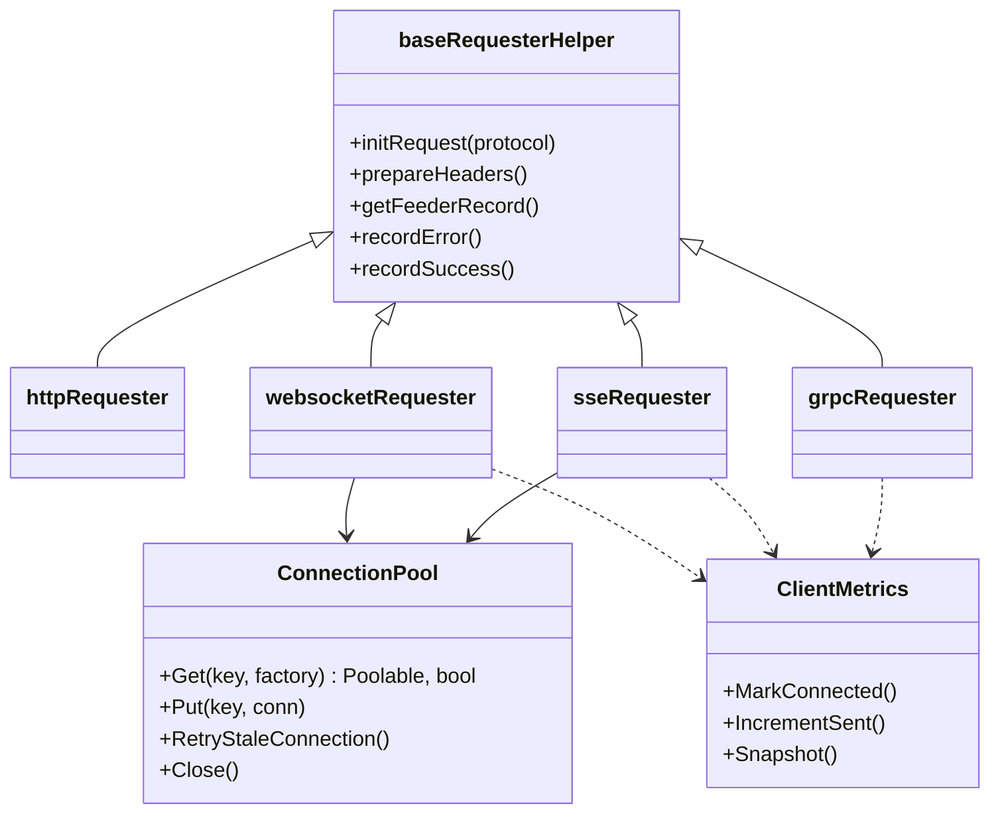



[Docs home](../../index.md) · [Overview](../1-project-overview.md) · [Architecture](../2-architecture-overview.md) · [Workflows](../3-workflow-overview.md)

# Deep Dive: Protocol Clients

## Overview

`cli.buildRequester` (`internal/cli/build.go`) turns `cfg.Protocol` into a `runner.Requester`. Each protocol is split into two layers:

- A **requester** in `internal/cli/*_requester.go` defines what one "request" means and how it is measured.
- A **client** in `internal/httpclient`, `internal/websocket`, `internal/sse` or `internal/grpcclient` speaks the wire protocol.

`internal/pool` reuses WebSocket and SSE connections across requests. `internal/clientmetrics` counts messages and bytes.

User-facing behaviour is described in [Protocols](../../protocols.md).

## Responsibilities

- Build the requester chain for the selected protocol. Only HTTP gets endpoint selection, retry and logging.
- Run one logical operation per `Do`, record latency and outcome, and return an error on failure.
- Classify failures into protocol-specific status buckets.
- Report per-request protocol metrics. WebSocket and SSE report deltas of the pooled client's counters. gRPC reports the counters of a client that is created fresh for each call, so they are per-call values.
- Reuse connections where the protocol allows it.

## Architecture



The diagram draws composition as inheritance. In the Go code there is no embedding: each requester has a named field `helper baseRequesterHelper` (for example `internal/cli/http_requester.go:34`).

## Key Files

- `internal/cli/build.go`: `buildRequester`, which dispatches per protocol and applies the HTTP decorator chain.
- `internal/cli/base_requester.go`: shared helpers for latency, metadata, headers, feeder, auth and tracing.
- `internal/cli/http_requester.go`, `websocket_requester.go`, `sse_requester.go`, `grpc_requester.go`: the per-protocol requesters.
- `internal/cli/endpoints.go`: the weighted `endpointSelector` (HTTP only).
- `internal/cli/status_meta.go`: `sanitizeStatusCode` and `fallbackStatusCode`.
- `internal/httpclient/client.go`, `internal/websocket/websocket.go`, `internal/sse/sse.go`, `internal/grpcclient/client.go`: the wire clients.
- `internal/pool/pool.go`, `internal/clientmetrics/metrics.go`: connection pooling and counters.

## Implementation Details

### HTTP

**Client.** One `http.Client` is shared by the whole run. It uses `Timeout = cfg.Timeout` and the tuned transport (256 idle connections, 32 per host, HTTP/2 attempted).

**One `Do`:**

1. Starts a span (`http_requester.go:54`).
2. Builds the request (feeder, placeholders, auth).
3. Injects trace headers into the built request, then calls `client.Do`.
4. Reads up to 1 MB of the body if the status is 400 or higher, or if the endpoint has extractors.
5. Drains the rest of the body.

**Failure** means a transport or build error, or a status of 400 or higher. A failed status becomes `runner.HTTPError` with up to 1 KB of the body.

**Proxy.** The transport uses `http.ProxyFromEnvironment`, so `HTTP_PROXY`, `HTTPS_PROXY` and `NO_PROXY` apply.

**Wrapping.** The requester is wrapped by `WithLogging` (with `--log-errors`), `WithRetry` (with `--retries`) and `endpointSelector.Wrap`, in that order from the inside out. Retries cover 429, 5xx and other errors, but not `context.Canceled` or `context.DeadlineExceeded` (`internal/cli/run.go:294`). `net/http` timeout errors match `DeadlineExceeded`, so per-request timeouts are never retried. Because logging sits inside retry, `--log-errors` prints every failed attempt.

### WebSocket

**One `Do`:**

1. Applies the feeder record and placeholders to the URL and messages.
2. Gets a pooled client, or creates and connects a new one.
3. Sends every configured message as a text frame, sleeping `message_interval` after each one when there are more than one.
4. If `receive_timeout > 0`, reads until that timeout expires. The timeout ending is treated as normal. Any other read error is a failure, including a normal server close (code 1000). Its status bucket is the close code (`websocket_requester.go:186-188,230-237`).

**Stale connections.** If the first send on a reused connection fails, the requester reconnects once with `RetryStaleConnection`.

**Returning to the pool:**

- After an error, the connection is closed.
- After a read timeout, it is also closed, because gorilla cannot reuse a connection after a read error.
- Otherwise it goes back to the pool.

**Metrics:** `connection_duration_ms`, `messages_sent`, `messages_received`, `bytes_sent`, `bytes_received`.

**Client:** `internal/websocket` wraps a gorilla `Dialer` with a 30 s default handshake timeout and `ProxyFromEnvironment`. `Close` sends a close frame.

### SSE

**Connect.** `internal/sse.Client.Connect` sends a GET with `Accept: text/event-stream`. A non-200 response returns `*StatusError`.

**Parsing.** `ReadEvent` parses `id`, `event` and `data` lines. Lines starting with `:` are comments. A blank line dispatches the event. EOF returns `connection closed`.

**One `Do`:**

1. Gets or connects a pooled stream.
2. Reads up to `max_events` events, within `read_timeout` if it is set.
3. If the first read on a reused stream fails, reconnects once.

**Returning to the pool.** A stream that hit the timeout is closed. A stream that reached `max_events` goes back to the pool.

**Pooling in practice.** The client's `http.Client.Timeout` is `read_timeout`, or 30 s when that is 0 (`sse_requester.go:85`, `sse/sse.go:61-63`). The timer starts at connect, so a pooled stream dies `read_timeout` after it was first opened, not after it was reused. On a reused stream, any error on the first read takes the stale-connection path and reconnects (`sse_requester.go:126-135`). That includes a plain timeout. So pooled SSE streams mostly cause reconnects.

**Early close.** If the server closes the stream before `max_events` or the timeout, the request fails with `read event: connection closed` (bucket `WRAPERROR`). The exception is the first read on a pooled stream, which reconnects once.

**Metrics:** `connection_duration_ms`, `events_received`, `bytes_received`.

**Client.** The client uses its own `http.Client{Timeout}` (`read_timeout`, or 30 s) on the default transport. That timeout bounds the **whole stream lifetime**.

### gRPC

**Descriptor.** The `.proto` file is parsed **once**, lazily, with `sync.Once`, using `protoparse` with the proto file's own directory as the only import path. A parse error is cached and fails every later request.

**Service and method lookup.** The service matches by its fully qualified name, its short name, or a `.Name` suffix. The method is found with `FindMethodByName`.

**Request.** The request is a `dynamic.Message` built from the JSON `message` after placeholders are applied. An empty message becomes `{}`.

**Metadata.**

- Keys are lowercased and trimmed.
- An `authorization: Bearer ...` entry is added when auth is configured.
- Trace context is injected.

**Connections.** One `*grpc.ClientConn` per **target** is kept in a `sync.Map`. When two dials race, `LoadOrStore` keeps one and the loser is closed. Connections are created with `grpc.NewClient`, which does not block.

**TLS.**

| Settings | Credentials |
|----------|-------------|
| `tls` and `insecure` | `InsecureSkipVerify` |
| `tls` only | system roots |
| neither | plaintext |

**Calls.** Only unary calls are supported, through `conn.Invoke("/<service>/<method>")`. A per-call deadline is applied only when `grpc.timeout > 0`.

**Metrics:** `messages_sent`, `messages_received`, `bytes_sent`, `bytes_received`, `status_code`. They are recorded **only after a successful call** (`grpc_requester.go:162-173`), so `status_code` is always `OK` and the counters cover successful calls only. Failures appear only in the status buckets.

### Connection pool

`pool.ConnectionPool` is a `sync.Map` from a key to a `chan Poolable` with capacity equal to `Concurrency`.

| Operation | Behaviour |
|-----------|-----------|
| `Get` | Never blocks. If no connection is free, calls the factory and returns `reused=false`. |
| `Put` | Closes the connection if the pool is full. |
| `MakePoolKey` | The target plus the headers in sorted order. |

The key is computed **before** trace headers are injected, so every request can still reuse a connection.

### Status bucket taxonomy

Buckets are recorded only for failures.

| Protocol | Bucket value |
|----------|--------------|
| http | Numeric status (`503`), otherwise the type name of the error (see below) |
| websocket | Close code (`1006`) when the error is a `CloseError`, otherwise the type name |
| sse | Type name only |
| grpc | `status.Code().String()` after sanitizing, e.g. `UNAVAILABLE`, `DEADLINEEXCEEDED` |

**Sanitizing.** `sanitizeStatusCode` uppercases the value, maps spaces, `/`, `.` and `-` to `_`, and trims `_`. An empty value becomes `UNKNOWN`.

**Fallback values.** `fallbackStatusCode` uses the Go type name of the error:

| Error | Bucket |
|-------|--------|
| `*url.Error` | `ERROR` (covers all HTTP transport errors and timeouts) |
| `fmt.Errorf` with `%w` | `WRAPERROR` |
| plain errors and `context.Canceled` | `ERRORSTRING` |
| `context.DeadlineExceeded` | `DEADLINEEXCEEDEDERROR` |
| `*sse.StatusError` | `STATUSERROR` |

## Dependencies

- Internal: `metrics`, `clientmetrics`, `pool`, `placeholders`, `feeder`, `auth`, `tracing`, `config`, `runner`.
- External: `gorilla/websocket`, `google.golang.org/grpc`, `jhump/protoreflect` (`protoparse`, `dynamic`), `google.golang.org/protobuf`.

## API/Interface

```go
// runner.Requester is the only contract the runner sees.
type Requester interface{ Do(ctx context.Context) error }

// internal/pool
func NewConnectionPool(size int) *ConnectionPool
func (p *ConnectionPool) Get(key string, factory func() Poolable) (client Poolable, reused bool)
func (p *ConnectionPool) Put(key string, client Poolable) error
func MakePoolKey(target string, headers http.Header) string

// internal/grpcclient
func Dial(ctx context.Context, cfg Config) (*grpc.ClientConn, error)
func NewClientWithConn(conn *grpc.ClientConn, cfg Config) *Client
func (c *Client) Invoke(ctx context.Context, req, resp proto.Message) error
```

## Testing

- **Per-requester unit tests** in `internal/cli`: `websocket_requester_test.go`, `sse_requester_test.go`, `grpc_requester_test.go`, `status_meta_test.go`.
- **Protocol integration** with in-process servers: `protocol_integration_test.go` and `features_matrix_protocols_test.go`.
- **Client packages:** `websocket_test.go`, `sse_test.go`, `client_test.go` and `client_security_test.go` (gRPC), `pool_test.go`.
- **Manual testing:** `scripts/testservers` provides test servers and `scripts/test-protocols.sh` drives them.

## Known Issues & Improvement Opportunities

- **Effective timeout defaults are 0.** WebSocket `receive_timeout`, SSE `read_timeout` and gRPC `timeout` all default to 0 (see [Configuration deep dive](configuration-and-request-building.md#known-issues--improvement-opportunities)). The consequences:
  - WebSocket skips the receive phase entirely.
  - gRPC has no per-call deadline.
  - SSE is bounded only by its client's 30 s timeout.
- **SSE `max_events: 0` is not unlimited.** It is forced to 100 (`internal/cli/sse_requester.go:107-109`), even though the config comment and flag help say 0 means unlimited.
- **Unused WebSocket settings.** `MaxMessageSize` (no `SetReadLimit`), `ReadTimeout` and `WriteTimeout` are accepted but never applied (`internal/websocket/websocket.go`). Sends have no write deadline.
- **WebSocket pooling only helps with receive off, and then the socket is never read.** In that mode server frames and pings are never read, and a dead connection is only detected on the next send. The sleep after the last message also counts toward latency.
- **gRPC sends the service name exactly as configured.** The wire path uses `cfg.Service` verbatim (`internal/grpcclient/client.go:122`). A short name such as `Greeter` resolves the descriptor but sends `/Greeter/SayHello`, so a packaged service will likely answer `Unimplemented`. Using the descriptor's fully qualified name would fix this.
- **gRPC dead fields.** `grpcclient.Config.Timeout`, `callCount` and `CallDuration` (which is always 0) are set but never used.
- **Status buckets that lose detail:**
  - WebSocket handshake failures become `WRAPERROR`, and the HTTP status is lost.
  - SSE non-200 responses become `STATUSERROR`, and the code is lost.
  - Every HTTP transport error becomes `ERROR`.
- **Stale pooled connections after token refresh.** Pool keys include `Authorization`, so after an OAuth refresh the old pooled WebSocket and SSE connections stay idle until the pool is closed.
- **Possible pool race.** `Close` closes each channel but leaves it in the map. A `Put` after `Close` panics on the closed channel. A `Get` after `Close` receives `nil, true` from the closed channel (`pool/pool.go:42-44`), and the requester's type assertion then panics (`websocket_requester.go:95`, `sse_requester.go:91`). Both need cleanup to run while a `Do` is still in flight. This has not been shown to happen.
- **gRPC protocol metrics ignore failures.** Because custom metrics are only attached on success, `protocol_metrics.grpc.status_code` is always `OK`.
- **HTTP-only features.** Retries and `--log-errors` are not wired for WebSocket, SSE or gRPC (`build.go`).

