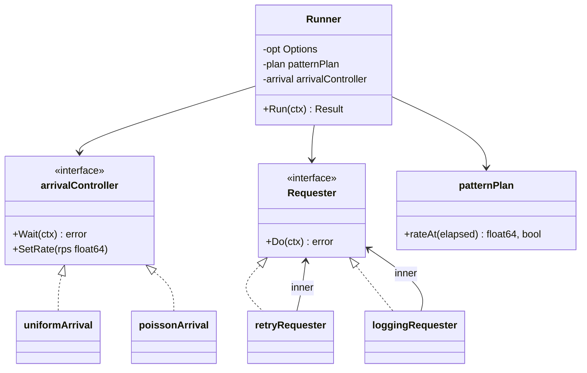



[Docs home](../../index.md) · [Overview](../1-project-overview.md) · [Architecture](../2-architecture-overview.md) · [Workflows](../3-workflow-overview.md)

# Deep Dive: Runner Engine

## Overview

`internal/runner` is protocol-agnostic. It decides **when** each request starts and **how many** run at once, and it stops the run cleanly. It knows nothing about URLs or metrics. It only calls `Requester.Do(ctx)` and counts the errors that come back.

## Responsibilities

- Normalize `Options` (minimum concurrency, default grace period, default limiter).
- Compile load patterns into a time-indexed rate plan and retune the arrival rate as the run progresses.
- Pace requests with a uniform (token bucket) or Poisson arrival model.
- Distribute permits to a fixed pool of workers.
- Stop on total count, duration, end of pattern plan, or parent cancellation, then drain in-flight work within `GracefulShutdown`.
- Provide `WithRetry` and `WithLogging` decorators.

## Architecture



## Key Files

- `internal/runner/options.go`: `Requester`, `Options`, `normalize()`, the `LoadPattern`/`LoadStep` types, and the `ArrivalModel` constants.
- `internal/runner/runner.go`: `Runner.Run`, the scheduler and worker goroutines, and `runPatternController`.
- `internal/runner/arrival.go`: `uniformArrival` (wraps `rate.Limiter`) and `poissonArrival`.
- `internal/runner/pattern_plan.go`: `compilePatternPlan` and `rateAt`.
- `internal/runner/retry.go`: `HTTPError`, `FailureLogger`, `RetryPolicy`, `WithRetry`, `WithLogging`.
- `internal/cli/run.go`: `newRetryPolicy`, which defines which errors are retried and the backoff.

## Implementation Details

### Options and defaults

`Options{Concurrency, TotalRequests, Duration, RatePerSecond, GracefulShutdown, Requester, LimiterFactory, LoadPatterns, ArrivalModel, RandomSeed, PoissonSampler}`.

`normalize()` applies these defaults:

| Field | Default |
|-------|---------|
| `Concurrency` | At least 1 |
| `GracefulShutdown` | `0` becomes 5 s; a negative value means cancel immediately |
| Limiter | `rate.NewLimiter(rps, max(1, rps/100))`, a burst of about 10 ms; `0` rps means `rate.Inf` |
| `RandomSeed` | `0` becomes `time.Now().UnixNano()` |

### Scheduler and workers

`Run` builds two contexts:

- `runCtx`: covers in-flight requests. It is cancelled when the parent is cancelled or when the grace timer expires.
- `schedulerCtx`: derived from `runCtx`. It adds the `Duration` timeout and the cancellation from the pattern plan.

The scheduler goroutine loops:

1. `arrival.Wait(schedulerCtx)`.
2. Atomically increment `total`.
3. Send a permit to `permits`, a `chan struct{}` buffered to `Concurrency`.

The loop stops when `schedulerCtx` ends, when `total >= TotalRequests` (if `TotalRequests > 0`), or when `Wait` returns an error.

Each worker loops `for range permits`. It wraps its context with `variables.NewContext(runCtx, variables.NewStore())`, which gives every worker its own chaining store. Then it calls `Requester.Do` and counts errors atomically.

When scheduling finishes, `permits` is closed. `Run` then waits for the workers for up to `GracefulShutdown` and calls `runCancel()` after that. If the parent context was cancelled, it just waits for the workers.

`Result{Total, Errors, Duration}` counts one entry per permit. Retries are not counted.

### Load patterns

The pattern types are `constant`, `ramp`, `step` and `spike`. `compilePatternPlan` converts them into ordered `patternSegment{start, duration, fromRate, toRate}` values and drops segments with zero duration. A `spike` compiles to a constant segment.

`rateAt(elapsed)` interpolates ramps linearly. It clamps every rate to at least 1 rps (`minPatternRate`), and returns `false` once the last segment has ended.

`runPatternController` calls `arrival.SetRate(rateAt(...))` every 100 ms. When the plan is exhausted it cancels the pattern context, and scheduling stops. If both `duration` and patterns are set, whichever finishes first ends the run.

### Arrival models

- **uniform**: a token bucket. `SetRate` updates both the limit and the burst (`max(1, rps/100)`). A rate of 0 or less means unlimited.
- **poisson**: sleeps for `ExpFloat64()/rate` seconds between arrivals, using a seeded sampler. A rate of 0 means no delay.

### Retry and logging decorators

`WithRetry(req, RetryPolicy{MaxAttempts, Delay, ShouldRetry, DelayFunc})` returns `req` unchanged when `MaxAttempts <= 1`. The loop aborts as soon as the context is cancelled.

The CLI policy (`newRetryPolicy`) works as follows:

| Setting | Value |
|---------|-------|
| `MaxAttempts` | `retries + 1` |
| Not retried | `context.Canceled`, `context.DeadlineExceeded`, and any `HTTPError` with a 4xx status other than 429 |
| Retried | HTTP 429 and 5xx, plus network and request-build errors. Request timeouts are **not** retried: `net/http` timeout errors match `context.DeadlineExceeded` |
| Backoff | `100ms * 2^(attempt-1)`, capped at 5 s, plus jitter in `[0, backoff/2)` |

`WithLogging` calls `FailureLogger.LogFailure(err)` for every failed attempt. The CLI's logger writes to stderr.

## Dependencies

- Internal: `internal/variables`, the only internal import.
- External: `golang.org/x/time/rate`.

## API/Interface

```go
type Requester interface{ Do(ctx context.Context) error }
func New(opt Options) *Runner
func (r *Runner) Run(ctx context.Context) Result
func WithRetry(req Requester, p RetryPolicy) Requester
func WithLogging(req Requester, l FailureLogger) Requester
type HTTPError struct{ StatusCode int; Body string }
```

## Testing

- `runner_test.go`: stop conditions, concurrency and grace behaviour.
- `arrival_test.go`: Poisson pacing only, with a seeded sampler. Uniform pacing is covered by `TestRateLimiterCapsThroughput` in `runner_test.go` and `TestLimiterFactory` in `options_test.go`.
- `pattern_plan_test.go`: segment compilation and interpolation.
- `options_test.go`: normalization.
- `retry_test.go` and `retry_behavior_test.go`: attempt counts and the predicate, with their own `DelayFunc`. The CLI's `newRetryPolicy` (backoff and retry predicate) has no unit test.
- End-to-end coverage of patterns comes from `internal/cli/features_matrix_loadpatterns_test.go`.

## Known Issues & Improvement Opportunities

- **Retry attempts are counted inconsistently.** The collector records every attempt, but `Result` counts one entry per permit. Reports and thresholds use collector numbers, while the exit check uses `Result.Errors`. So an attempt that fails and then succeeds on retry still adds to `failures` and to thresholds, but not to `Result.Errors`.
- **Cancelled requests show up as failures.** On parent cancel (Ctrl+C, `q` in the dashboard), `runCtx` is cancelled at once (`runner.go:137-139`), with no grace window. In-flight requests fail, and buffered permits run `Do` with a cancelled context. All of them are recorded as failures and counted in `Result.Errors`. An interrupted one-shot run therefore normally ends with `N requests failed` and exit 1.
- **Retries ignore the run deadline.** `Duration` only stops scheduling, so retry chains already in flight continue through the grace window.
- **Patterns cannot go below 1 rps.** `minPatternRate` is marked `shortcut:` in `pattern_plan.go`, so a ramp that starts at 0 actually starts at 1 rps.
- **Pacing has a single bottleneck.** One scheduler goroutine controls all pacing. That is fine for typical rates but is a ceiling for extreme RPS.

