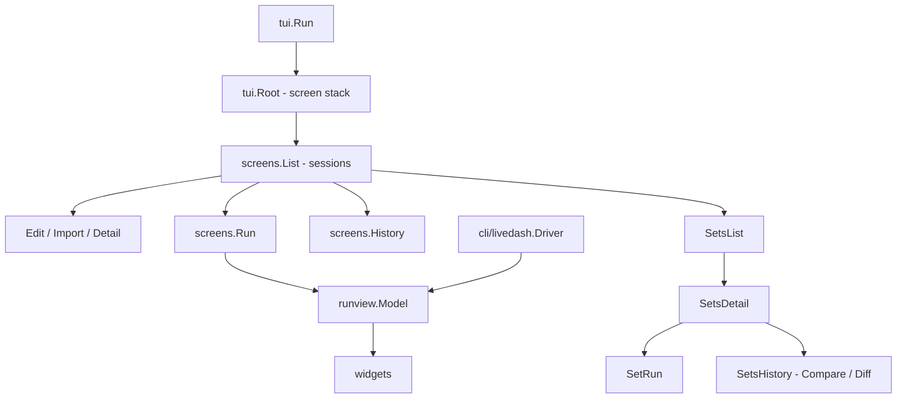



[Docs home](../../index.md) · [Overview](../1-project-overview.md) · [Architecture](../2-architecture-overview.md) · [Workflows](../3-workflow-overview.md)

# Deep Dive: Terminal UI

## Overview

Crankfire has two Bubble Tea front ends. They render live runs with the same view:

- **`crankfire tui`** (`internal/tui`) is a full-screen app for managing sessions and sets, running them, and browsing history.
- **`--dashboard`** (`internal/cli/livedash`) is a live view of a single one-shot CLI run.

Both render live runs with `internal/tui/runview.Model`, which is assembled from `internal/tui/widgets`.

For the user guide, see [Terminal UI](../../tui.md) and [Dashboard & Reporting](../../dashboard-reporting.md).

## Responsibilities

- Navigate between screens using a stack.
- Create, edit and import sessions. Edits use a form or raw YAML.
- Filter sessions and sets by tag.
- Run a session in-process with a live dashboard, then persist `result.json` and `report.html`.
- Edit, run, compare and diff sets. Create sets from templates.
- Render a responsive dashboard: run summary, RPS, latency trend, percentiles, endpoints, status buckets, protocol metrics and load-pattern progress.

## Architecture



## Key Files

- `internal/tui/tui.go`: `Run` resolves the data dir, creates the store, and starts `tea.NewProgram` with the alt screen and mouse cell motion.
- `internal/tui/root.go`: the `Root` stack. It handles `PushMsg` and `PopMsg`, and a global `q` when only one screen is on the stack.
- `internal/tui/screens/`, session screens: `list.go`, `filter_bar.go`, `confirm.go`, `detail.go`, `edit_form.go`, `import.go`, `history.go`, `run.go`.
- `internal/tui/screens/`, set screens: `sets_list.go`, `sets_detail.go`, `sets_edit.go`, `set_run.go`, `sets_history.go`, `sets_compare.go`, `sets_diff.go`, `template_picker.go`.
- `internal/tui/runview/`: the dashboard model and its `SnapshotMsg`, `RequestContext` and `LoadPattern` strip.
- `internal/tui/widgets/`: progress and target bars, sparklines, trend chart, endpoint and percentile tables, status buckets, protocol metrics.
- `internal/cli/livedash/livedash.go`: `Driver`, `BuildSnapshot`, endpoint rows.
- `internal/cli/dashboard_context.go`: `BuildDashboardContext`, which builds the header data and takes the SLO from the first `http_req_duration:p95` threshold that uses `<` or `<=`.

## Implementation Details

### Screen stack

`Root` holds a `[]tea.Model` stack, starting with `screens.NewList`. Messages are handled as follows:

- **`PushMsg{Model}`** appends a screen and returns its `Init()`.
- **`PopMsg`** removes the top screen (never the last one) and **calls `Init()` on the screen it reveals**. This is how lists refresh.
- **Any other message** goes to the top screen. The model it returns **replaces** the top screen without `Init()` being called.
- **`q`** quits the app before the screen sees the key, but only when the stack has a single screen.

### Screens and keys

| Screen | Keys |
|--------|------|
| Sessions list | `j`/`k` or arrows to move. `enter` details, `n` new, `e` edit, `i` import, `r` run, `h` history, `s` sets, `d` delete (asks to confirm), `/` filter, `x` clear filter, `q`/`ctrl+c` quit. |
| Filter bar | `/` opens it. `enter` applies. `esc` cancels. Syntax: spaces mean AND, commas mean OR. |
| Detail | `esc` back, `r` run, `h` history |
| Edit (form) | Fields: Name, Target, Protocol, Total, Rate, Duration, Concurrency, Timeout. `tab`/`down` and `shift+tab`/`up` move between fields; `tab`/`down` on the last field switches to YAML mode. `F2` toggles YAML mode. `ctrl+s` saves. `esc` cancels. |
| Edit (YAML) | Edits the whole `Session` document; the ID cannot be changed. `F2` returns to the form. `ctrl+s` saves. |
| Import | Fields: Path, Name. `enter` imports through `ImportSessionFromConfigFile`. |
| Run | `q`/`esc`/`ctrl+c` cancel the run. The screen pops itself as soon as the run is finalized, so the final dashboard is not left on screen. |
| History | Columns: Started, Status, Total, P95ms, Errors. `o` opens `report.html` with `open`, `xdg-open` or `start`. `esc` back. |
| Sets list | `n` new, `enter` details, `t` template picker, `d` delete (**no confirmation**), `r` refresh, `/` filter, `q`/`esc` quit the app |
| Sets detail | `e` edit, `R` run, `h` history, `esc`/`q` back |
| Sets edit | Name and Description in a form. `y` switches to YAML, `f` back to the form. `ctrl+s` saves. `esc` cancels. |
| Set run | Shows stage and item progress. `esc`/`q` cancel, or open Compare once the run has finished. |
| Sets history | `space` marks a run, `enter` compares, `d` diffs two marked runs, `esc` back |
| Template picker | Lists `templates/*.yaml` (in `Init`, which currently never runs; see Known Issues). Parameter grid: `tab` moves, `ctrl+n` adds a row, `ctrl+s` creates the set. |

### Single-session run (`screens/run.go`)

1. `Init` calls `store.CreateRun`, which writes `run.json` with status `running`.
2. It then calls `cli.BuildRunner(runCtx, sess.Config)` and runs the runner in a goroutine.
3. A 250 ms tick calls `collector.Snapshot()` and passes the latest `DataPoint` to `runview`. The goroutine reports that it has finished through a package-level `finishPending` map, which the tick drains.
4. On completion, `finalizeCmd` writes `result.json` (the JSON report) and `report.html` into the run directory, calls `FinalizeRun`, and pops the screen.

No thresholds are evaluated. If the run had any errors, the error message is set, and `FinalizeRun` changes the status to `failed`.

### runview

`runview.New(Options{Title, Total, Header, RequestContext, LoadPattern})` takes the SLO marker from `RequestContext.LatencySLOMs`. It consumes `SnapshotMsg{Snap, Endpoints, Stats, StatusBuckets, ProtocolMetrics, Elapsed}` and `tea.WindowSizeMsg`. It renders these panels:

- Run Summary: elapsed time, totals, success rate, progress.
- RPS strip: a target bar coloured by actual/target ratio (at most 1, at most 1.2, or above).
- Request Context.
- Latency Trend: a 120-sample p95 ring with P50/P95/SLO markers.
- Latency Stats.
- Protocol Metrics, or a Load Pattern progress strip when patterns are configured.
- Endpoints.
- Status Buckets.

At 80 columns or wider, rows are laid out side by side. Narrower terminals stack them.

### livedash

`livedash.New(collector, Opts, cancel)` wraps a `runview.Model` in a `Driver` and runs it in `tea.NewProgram(WithAltScreen())` on a goroutine.

- `Start` waits 100 ms to catch startup failures, such as a missing TTY.
- Every 500 ms it calls `collector.Snapshot()` and then `BuildSnapshot`, which assembles a full `SnapshotMsg` with endpoint rows sorted by count.
- `q`, `esc` and `ctrl+c` call the run's cancel function.

`Stop` restores the terminal before `cli.Run` prints the final report.

## Dependencies

- Internal: `store`, `setrunner`, `cli` (for `BuildRunner`, `NewSetBuilder` and `BuildDashboardContext`), `metrics`, `output`, `tagfilter`, `template`.
- External: `charmbracelet/bubbletea`, `bubbles` (textinput, textarea), `lipgloss`, `gopkg.in/yaml.v3`.

## API/Interface

```go
func tui.Run(opts tui.Options) error              // Options{DataDir}
func tui.NewRoot(s store.Store) Root
type screens.PushMsg struct{ Model tea.Model }
type screens.PopMsg struct{}
func runview.New(opts runview.Options) runview.Model
func livedash.New(c *metrics.Collector, opts livedash.Opts, shutdown func()) *Driver
func livedash.BuildSnapshot(c *metrics.Collector, elapsed time.Duration) runview.SnapshotMsg
```

## Testing

- **Screen models** are unit-tested by sending `tea.Msg` values directly to them. See `internal/tui/screens/*_test.go`, for example `edit_yaml_test.go`, `filter_bar_test.go`, `set_run_test.go` and `sets_diff_test.go`.
- **`internal/tui/runview/runview_test.go`** and **`loadpattern_test.go`** cover layout and the load-pattern strip.
- **`internal/tui/widgets/*_test.go`** cover the widgets.
- **`internal/cli/livedash/livedash_test.go`** covers snapshot building.
- **`cmd/crankfire/tui_integration_test.go`** drives the real binary in a pseudo-terminal using `hinshun/vt10x` (build tag `integration`).

## Known Issues & Improvement Opportunities

- **Screens swapped in place are never `Init`ed.** Many set screens move on by returning a new model instead of sending `PushMsg`/`PopMsg`. Root only calls `Init` on push or pop, so these models never load. Forward moves:
  - `R` → `NewSetRun` (`sets_detail.go:56`). `SetRun` starts the set in `Init`, so the set never runs.
  - `h` → `NewSetsHistory` (`sets_detail.go:58`). History opens empty.
  - `t` → `NewTemplatePicker` (`sets_list.go:124`). Its `Init` calls `ListTemplates`, so no templates are listed.
  - In `sets_history.go:46-76`, `enter` → `NewSetCompare` and `d` → `NewSetsDiff`.

  Back moves are affected too. These return fresh models instead of popping, so the screens show empty and the stack keeps growing:
  - `sets_detail.go:52` (`esc` → `NewSetsList`)
  - `sets_edit.go:70,136`
  - `sets_compare.go:35`
  - `sets_diff.go:31`
  - `template_picker.go:105,233`

  The unit tests call `Init()` directly, so they do not catch this.
- **Import lands back on the Import screen.**
  - `import.go:92-95` returns `tea.Sequence(Push Edit, Pop)`, which pushes the Edit screen and immediately pops it.
  - The imported `Session` also has no ID set (`SaveSession` takes the session by value), so saving from that Edit screen would create a duplicate.
- **The TUI single run shows partial data.** It sends only `Snap`, so the endpoint, status-bucket, protocol-metric and elapsed panels stay empty or show zero (`screens/run.go`). Using `livedash.BuildSnapshot` would fix this.
- **`q` in the sessions filter quits.** Root intercepts `q` while the user is typing into the filter prompt on the sessions list, so it quits the app instead of entering the letter (`root.go:22`).
- **Single-letter mode keys in sets edit.** `y` and `f` switch between form and YAML even while the user is typing into a field.
- **Sets list `q`/`esc` quit the whole app** instead of returning to the sessions list.
- **The detail footer advertises `[e] edit`, but the key is not handled** (`detail.go`).
- **Windows report opening** uses `exec.Command("start", …)`, which is not an executable, so `o` likely fails on Windows.
- **Cancel before start leaves a run behind (from code reading).** Pressing `q` before `runStartedMsg` arrives finalizes and pops the screen immediately, because `r.run` and `r.cancel` are still unset (`screens/run.go:236-248`). The `startCmd` from `Init` keeps going in the background (`screens/run.go:108-130`): it creates `run.json` and starts the runner with no handle to cancel it. The load test then runs to completion unattended, and `run.json` stays `running`.
- **Unsafe report writes.** `result.json` and `report.html` are written with `os.Create` rather than atomically, and their errors are ignored.

